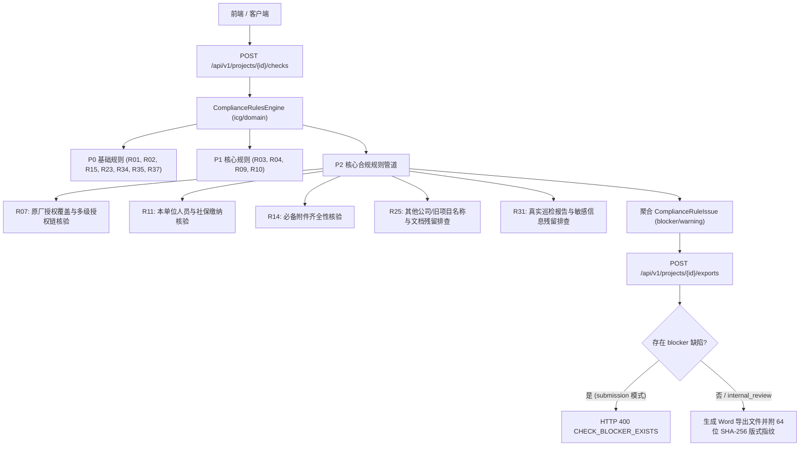

# 代码说明：PRD P2 核心合规规则引擎扩充与导出门禁联动（BE-COMPLIANCE-RULES-P2）

## 1. 架构定位与设计理念

`BE-COMPLIANCE-RULES-P2` 扩展落地于 `backend/bid-core/icg/domain/compliance_rules.py`，属于投标合规规则引擎的核心业务领域层。
该模块承接项目状态（`DemoState`）、项目元数据、工作流矩阵（`workflow`）以及企业资料库资质材料（`state.library`），在执行导出门禁或合规检查中心调用时，对原厂授权、拟派团队社保、法定必备附件、旧标书残留排查及敏感信息泄露执行确定性规则审查。

---

## 2. 核心模块实现细节

### 2.1 R07 原厂授权覆盖与多级授权链核验 (`check_r07`)
- **适用场景判断**：扫描条款中是否包含“原厂授权”、“原厂商授权”、“原厂服务承诺”、“制造商授权”等关键词；未要求时自动放行；
- **声明排查**：若条款响应明确写有“无法提供原厂授权”或未挂接授权材料，直接判定 `blocker`（`ORIGINAL_MANUFACTURER_AUTHORIZATION_MISSING`）；
- **授权覆盖核验**：提取条款指定的产品（如 Oracle数据库、MySQL数据库等），核验挂接授权材料覆盖的产品范围；若未覆盖指定产品或声明未覆盖，判定 `blocker`（`ORIGINAL_MANUFACTURER_AUTHORIZATION_MISSING`）；
- **有效期覆盖**：核验原厂授权书有效截止期是否能覆盖项目投标截止时间；
- **多级授权链完整性**：对于代理授权或转授权，核验是否存在上级原厂授权；若授权链断裂或上游缺失，判定 `blocker`（`ORIGINAL_MANUFACTURER_AUTHORIZATION_MISSING`）。

### 2.2 R11 本单位人员与社保缴纳核验 (`check_r11`)
- **响应借调与挂靠排查**：扫描条款响应文本，排查“非本单位”、“外部借调”、“挂靠”、“第三方代缴”、“社保不在本单位”等违规用语；命中直接判定 `blocker`（`PERSONNEL_SOCIAL_SECURITY_MISMATCH`）；
- **证明材料齐全性**：条款明确要求社保证明但未挂接材料时判定 `blocker`（`PERSONNEL_SOCIAL_SECURITY_MISMATCH`）；
- **缴纳单位与连续性核验**：审查挂接的社保证明材料，若缴纳单位与投标主体不一致或存在断缴未连续缴纳，判定 `blocker`（`PERSONNEL_SOCIAL_SECURITY_MISMATCH`）；
- **劳动合同有效性**：核验拟派人员劳动合同有效截止期在投标截止时间是否有效。

### 2.3 R14 必备附件齐全性核验 (`check_r14`)
- **5 大强制必备附件清单**：开标一览表（`quotation_sheet`）、法定代表人身份证明与授权委托书（`legal_auth`）、投标保证金证明或电子保函（`bid_bond`）、承诺函（`commitment_letter`）、资质证书附件（`qualification_cert`）；
- **核验源多维汇总**：从上传文件（`workflow.files`）、企业资料库（`state.library`）、编制章节（`state.chapters`）及显式登记字典（`mandatory_attachments`）统一归集；
- **缺项阻断**：招标文件强制要求（条款指定或项目全局开启）的必备附件中，缺失任一项均判定为 `blocker`（`MANDATORY_ATTACHMENT_MISSING`）。

### 2.4 R25 其他公司/旧项目名称与文档残留排查 (`check_r25`)
- **扫描范围**：章节全部正文与条款响应矩阵文本；
- **残留特征模式**：排查“某某科技”、“某某公司”、“XXX公司”、“【旧标残留】”、“参考原项目名称”等旧标书复制遗留占位特征；同时匹配显式配置的禁忌历史实体；
- **检测阻断**：发现残留即判定为 `blocker`（`ENTITY_NAME_RESIDUAL_DETECTED`）。

### 2.5 R31 真实巡检报告与敏感信息残留排查 (`check_r31`)
- **18位明文身份证**：正则扫描未脱敏的 18 位身份证号码（排除已脱敏带 `*` 号）；
- **银行卡号明文**：排查未脱敏的对公银行账户与 16~19 位银行卡号明文；
- **明文口令**：排查正文中的数据库配置口令（`password=...`、`db_password=...`）；
- **真实客户巡检报告套用**：排查正文套用“现场巡检报告”、“机房巡检记录”等实地运维报告段落特征；
- **检测阻断**：违规暴露高敏数据或套用现场报告即判定为 `blocker`（`SENSITIVE_DATA_RESIDUAL_DETECTED`）。

---

## 3. 测试覆盖设计

专属测试套件 `tests/backend/test_compliance_rules_p2.py` 覆盖 6 大典型测试场景：
1. `test_r07_original_manufacturer_authorization`：原厂授权正例通过、未挂接材料阻断、响应声明无授权阻断、授权过期阻断、产品未覆盖阻断、多级授权链断裂阻断；
2. `test_r11_personnel_and_social_security`：本单位社保正例通过、借调人员阻断、社保证明缺失阻断、社保单位不一致阻断、社保断缴阻断；
3. `test_r14_mandatory_attachments_verification`：必备附件强制要求缺少开标一览表/授权书/保函/承诺函时阻断、逐项补齐后通过；
4. `test_r25_entity_name_and_legacy_residuals`：正文清洁通过、某某科技占位残留阻断、原项目名称旧标残留阻断、条款响应其他公司残留阻断；
5. `test_r31_sensitive_data_and_real_inspection_residuals`：脱敏合规通过、18位明文身份证暴露阻断、银行卡号明文阻断、数据库明文口令阻断、真实巡检报告套用特征阻断；
6. `test_export_gate_blocked_by_p2_compliance_rules`：存在上述 P2 blocker 缺陷时，正式递交版导出严格触发 400 `CHECK_BLOCKER_EXISTS`。
