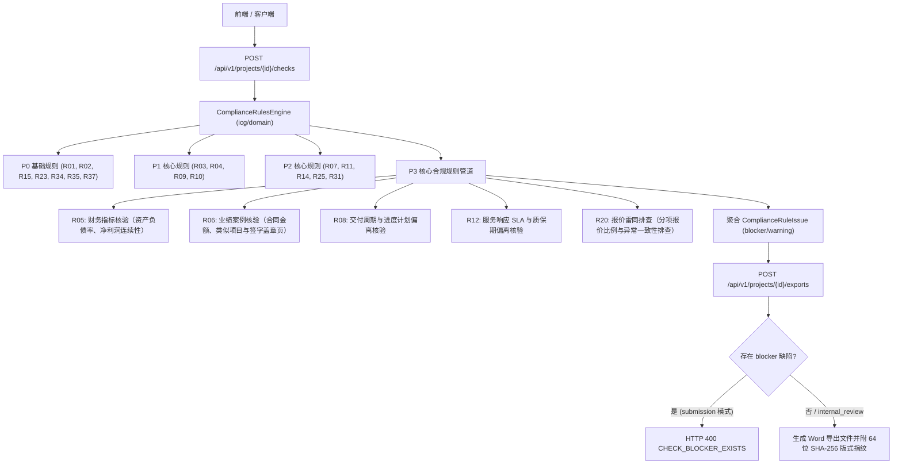

# 代码说明：PRD P3 核心合规规则引擎扩充与导出门禁联动（BE-COMPLIANCE-RULES-P3）

## 1. 架构定位与设计理念

`BE-COMPLIANCE-RULES-P3` 扩展落地于 `backend/bid-core/icg/domain/compliance_rules.py`，属于投标合规规则引擎的核心业务领域层。
该模块承接项目状态（`DemoState`）、项目元数据、工作流矩阵（`workflow`）以及企业资料库（`state.library`），在执行导出门禁或合规检查中心调用时，对企业财务状况、业绩案例、交付周期、服务响应 SLA 与质保期偏离以及报价雷同串标风险执行确定性、可解释的规则判定。

---

## 2. 核心模块实现细节

### 2.1 R05 财务指标核验 (`check_r05`)
- **适用场景判断**：扫描条款中 `category in ("financial", "finance")` 或文本包含“财务”、“资产负债率”、“净利润”、“审计报告”、“财务状况”、“资不抵债”、“连续盈利”等关键词；
- **声明与实质性负偏离排查**：未填写响应说明或 `deviation_type in ("negative", "负偏离")` 时直接判定 `blocker`（`FINANCIAL_METRICS_NON_COMPLIANT`）；
- **资不抵债与亏损排查**：响应明确出现“资不抵债”、“净利润为负”、“连续亏损”、“出现亏损”、“未连续盈利”、“资产负债率超标”等否定性描述时判定 `blocker`（内置否定前缀排除，防止“未出现亏损”误判）；
- **资产负债率上限数值核验**：正则提取招标文件规定的最高上限（如不超过 70%），并从响应说明或挂接审计报告（`state.library`）中提取投标主体的资产负债率；若投标主体负债率大于最高上限，直接判定 `blocker`；
- **近三年净利润为正核验**：核验审计报告及说明是否保持近三年净利润连续为正；
- **商务正文巡检**：排查商务章节正文中是否存在“严重资不抵债”或重大亏损违规描述。

### 2.2 R06 业绩案例核验 (`check_r06`)
- **适用场景判断**：扫描条款中 `category in ("performance", "case")` 或文本包含“业绩”、“同类项目”、“类似项目”、“案例”、“合同业绩”等关键词；
- **无响应与实质性负偏离排查**：响应为空或 `deviation_type in ("negative", "负偏离")` 判定 `blocker`（`PERFORMANCE_CASE_INSUFFICIENT`）；
- **门槛金额数值核验**：从招标文件提取单项合同金额门槛（如不少于 500 万元），从投标响应及挂接的业绩证明材料中提取业绩案例合同金额；若金额低于门槛要求，判定 `blocker`；
- **签字盖章页与验收证明核验**：当招标文件要求双方签字盖章页或验收报告时，若挂接材料标注“缺少盖章页”、“未盖章”、“无验收证明”或缺少验收报告，判定 `blocker`；
- **近三年有效期限核验**：核验合同签订年份（如距今超过 3 年，如 2019 年合同），判定 `blocker`；
- **材料齐全性核验**：要求提供合同附件但未挂接任何资料库材料且未说明提供时判定 `blocker`。

### 2.3 R08 交付周期与进度计划偏离核验 (`check_r08`)
- **适用场景判断**：扫描条款中包含“交付周期”、“交付天数”、“交货期”、“交付时限”、“完工时限”、“日历天”、“进度计划”等关键词；
- **无响应与实质性负偏离排查**：未作响应承诺或 `deviation_type in ("negative", "负偏离")` 判定 `blocker`（`DELIVERY_TIMELINE_NEGATIVE_DEVIATION`）；
- **负偏离声明排查**：响应明确说明“超出交付周期”、“无法按期完成”、“交期超出”、“延长工期”等词句时判定 `blocker`；
- **上限天数数值对比**：提取招标文件限定的交付天数上限（如 60 日历天）与投标响应承诺的交付天数（如 90 日历天）；若承诺天数大于招标上限，判定为重大负偏离违规 `blocker`。

### 2.4 R12 服务响应 SLA 与质保期偏离核验 (`check_r12`)
- **适用场景判断**：扫描条款包含“质保期”、“维保期”、“免费质保”、“响应时间”、“到达现场”、“SLA”等关键词；
- **质保期年限对比**：提取招标文件最低质保年限（如不少于 3 年）与投标承诺质保年限（如 1 年）；若承诺年限低于最低要求，判定 `blocker`（`SLA_WARRANTY_NEGATIVE_DEVIATION`）；
- **现场到达响应时间对比**：提取招标文件限定的现场到达时间上限（如 2 小时）与承诺时间（如 4 小时）；若承诺到达时间超出限定时限，判定 `blocker`；
- **SLA 核心指标联动**：核验 `workflow.get("sla", {}).get("values")` 中的指标；若存在标记为实质性负偏离的指标，判定 `blocker`。

### 2.5 R20 报价雷同排查 (`check_r20`)
- **正文与响应排查**：对正文（重点为商务分册 `business` 章节）与条款响应执行串标特征扫描；排查“分项报价比例异常一致”、“报价雷同”、“复制其他投标主体报价”、“串通投标风险”、“分项报价呈固定比例成倍递增”等违规高危特征；命中即判定为 `blocker`（`BID_PRICE_COLLUSION_RISK_DETECTED`）；
- **结构化报价清单核验**：检查 `workflow.get("quotation")` 或 `pricing` 数据中的串标风险标志（如 `collusion_risk=True`、`identical_breakdown_ratio=True`），发现异常一致性即判定为 `blocker`。

---

## 3. 测试覆盖设计

专属测试套件 `tests/backend/test_compliance_rules_p3.py` 覆盖 6 大典型测试场景：
1. `test_r05_financial_metrics_compliance`：企业财务审计报告正例放行、资产负债率超标阻断（82.5% > 70%）、近三年净利润亏损阻断、未承诺阻断、严重资不抵债负偏离阻断；
2. `test_r06_performance_case_sufficiency`：业绩案例正例放行（680万 > 500万，双方盖章验收齐全）、金额不足阻断（260万 < 500万）、缺少双方盖章页阻断、缺少验收证明阻断、合同超出近三年有效期限阻断；
3. `test_r08_delivery_timeline_deviation`：交付工期正例放行（45天 <= 60天）、承诺交付天数超出上限阻断（90天 > 60天）、响应声称超出交期阻断、未填写响应阻断；
4. `test_r12_sla_warranty_deviation`：SLA 与质保正例放行（3年质保与1小时到达）、质保期低于基线阻断（1年 < 3年）、现场到达响应时间超时阻断（4小时 > 2小时）、明确负偏离阻断；
5. `test_r20_quotation_collusion_risk_detection`：独立自主测算正例放行、正文排查到分项报价比例异常一致特征阻断、正文排查到复制其他投标主体报价特征阻断、条款响应排查到串通投标风险特征阻断；
6. `test_export_gate_blocked_by_p3_compliance_rules`：在项目中植入 R08 交付周期超期 blocker 缺陷，执行 checks 校验确认包含 blocker，发起 submission 模式导出，断言严格触发 400 `CHECK_BLOCKER_EXISTS`，保证导出门禁坚固可靠。
