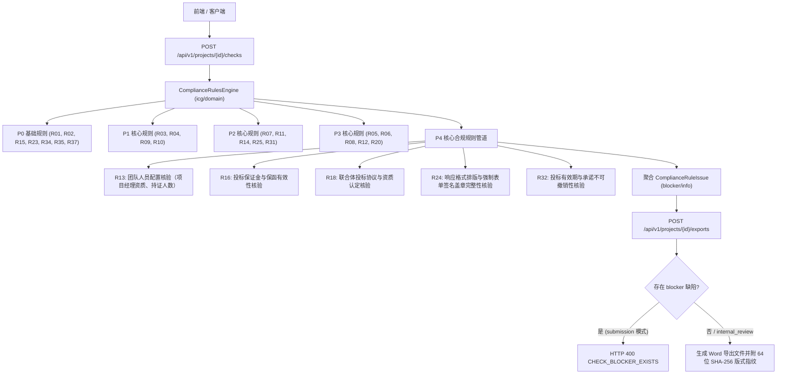

# 代码说明：PRD P4 核心合规规则引擎扩充与整本导出门禁联动（BE-COMPLIANCE-RULES-P4）

## 1. 架构定位与设计理念

`BE-COMPLIANCE-RULES-P4` 扩展落地于 `backend/bid-core/icg/domain/compliance_rules.py`，属于投标合规规则引擎的核心业务领域层。
该模块承接项目状态（`DemoState`）、项目元数据、工作流矩阵（`workflow`）以及企业资料库（`state.library`），在执行导出门禁或合规检查中心调用时，对拟派团队人员资质（R13）、投标保证金与保函（R16）、联合体协议（R18）、法定表单签名盖章（R24）以及投标有效期不可撤销性（R32）执行确定性、可解释的规则判定。

---

## 2. 核心模块实现细节

### 2.1 R13 团队人员配置核验 (`check_r13`)
- **适用场景判断**：扫描条款中包含“项目经理”、“技术负责人”、“执业资格”、“建造师”、“PMP”、“人员配置”、“团队配置”、“持证人数”、“专业技术人员”等关键词；
- **项目经理资质与社保排查**：排查响应说明中的实质性否定前缀（如“无证书”、“不具备执业资格”、“执业资格缺失”、“未取得建造师”、“暂未取得”、“社保未缴纳”、“社保证明缺失”、“社保断缴”等），匹配到任一项直接判定 `blocker`（`TEAM_PROJECT_MANAGER_QUALIFICATION_MISSING`）；
- **资质证书与社保证明挂接核验**：若条款明确要求提供执业证书或社保证明，核验是否在条款或章节中挂接了已确认的企业资料库资质凭据（`state.library`），未挂接且无证明标记判定 `blocker`；
- **持证人数门槛核验**：正则提取招标文件要求的最低技术人员配置人数（`不少于 X 人`）与投标响应承诺配备人数（`配备/配置 Y 人`）；若承诺人数小于招标文件最低门槛，判定 `blocker`（`TEAM_STAFFING_THRESHOLD_UNMET`）。

### 2.2 R16 投标保证金与保函有效性核验 (`check_r16`)
- **适用场景判断**：扫描条款中包含“保证金”、“投标保证金”、“投标保函”、“保函”、“投标担保”等关键词；
- **无响应与实质性缺陷排查**：未作响应承诺直接判定 `blocker`（`BID_SECURITY_DEPOSIT_NON_COMPLIANT`）；
- **金额足额与汇出主体核验**：响应明确说明“保证金不足”、“未足额”、“第三方代缴”、“代缴”、“账户不一致”、“非基本户”等实质性缺陷时，判定 `blocker`；
- **保函有效期覆盖核验**：排查“保函过期”、“有效期不足”、“未覆盖投标有效期”等违规情形，判定 `blocker`。

### 2.3 R18 联合体投标协议与资质认定核验 (`check_r18`)
- **非联合体投标智能放行**：通过条款响应、项目事实（`workflow.get("facts")`）中声明的“非联合体”、“独立投标”、“单独投标”、“不采用联合体”进行快速判定，非联合体直接以 `info` 级别通过；
- **联合体协议书完整性核验**：若确认采用联合体投标，核验联合体成员是否均挂接有效协议书（`agreement_attachment_id` 或挂接企业资料库材料）；协议缺失或未签署判定 `blocker`（`CONSORTIUM_AGREEMENT_INVALID`）；
- **牵头人法定授权与资质分工核验**：核验是否明确指定牵头人（`is_lead`）或牵头方书面授权证明；若牵头人未授权或成员资质不足、擅自分包变更，判定 `blocker`。

### 2.4 R24 响应格式排版与强制表单签名盖章完整性核验 (`check_r24`)
- **法定表单识别**：定位标题或条款包含“投标函”、“法定代表人身份证明”、“授权委托书”、“签署页”、“签字盖章页”、“承诺书”等法定核心表单的章节；
- **显式未盖章/未签名标记排查**：正文或响应中出现“(未盖章)”、“未盖公章”、“[未签名]”、“未签字”、“签名缺失”、“待盖章”等未完成占位描述时，直接判定 `blocker`（`MANDATORY_SEAL_SIGNATURE_MISSING`）；
- **空表单拦截**：法定关键表单章节正文为空时，直接判定 `blocker`；
- **有效盖章标记完备性校验**：对投标函、授权委托书等法定表单核验是否具备合法盖章占位标记（如 `(盖章)`、`（签字）`、`[公章]` 等）。

### 2.5 R32 投标有效期与承诺不可撤销性核验 (`check_r32`)
- **招标有效期提取**：优先从事实库 `facts` 或招标文件条款中正则提取招标要求的日历天数（如不少于 90 日历天）；
- **承诺天数数值对比**：提取投标响应承诺的有效日历天数（如 60 天）；若承诺天数小于招标要求天数，判定重大负偏离 `blocker`（`BID_VALIDITY_PERIOD_DEFICIENT`）；
- **承诺不可撤销性排查**：排查承诺中是否含有“可撤销”、“可撤回”、“附带撤销条件”、“保留修改权利”等违规附条件描述，发现且无否定词保护时直接判定 `blocker`；
- **投标函正文巡检**：同步扫描包含“投标函”标题章节正文中的可撤销或提前终止风险词句。

---

## 3. 测试覆盖与验证映射

| 测试用例名称 | 对应测试函数 | 覆盖要点 |
|---|---|---|
| R13 团队人员配置核验 | `test_r13_team_staffing_compliance` | 一级建造师+PMP+连续社保放行，证书缺失/社保缺失/人数未达标阻断 |
| R16 投标保证金与保函核验 | `test_r16_bid_security_deposit_compliance` | 10万元足额+基本户+有效期覆盖放行，不足额/第三方代缴/保函过期阻断 |
| R18 联合体投标协议核验 | `test_r18_consortium_agreement_compliance` | 独立投标免检放行，协议完备放行，协议缺失/牵头人未授权/擅自分包阻断 |
| R24 强制表单签名盖章核验 | `test_r24_mandatory_seal_signature_compliance` | 签字盖章标记完备放行，未盖章/未签名/空表单强阻断 |
| R32 投标有效期不可撤销性 | `test_r32_bid_validity_period_compliance` | 90天满足且不可撤销放行，60天缩水/可撤销附条件强阻断 |
| 导出门禁联动 | `test_export_gate_blocked_by_p4_compliance_rules` | 存在 P4 blocker 时正式递交版 400 拦截，内部评审版放行并附合规警示 |
