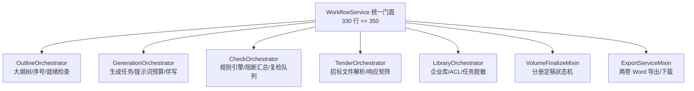

# 代码说明：workflow_orchestrator 巨石解耦与领域子编排服务细化（BE-TECH-DEBT-03）

- 对应任务：[BE-TECH-DEBT-03](../tasks/BE-M0.md#be-tech-debt-03) · workflow_orchestrator 巨石解耦与领域子编排服务细化
- 关联 Issue：[ISSUE-038](../../issues/ISSUE-038.md)
- 交付文档：[BE-TECH-DEBT-03 交付](../delivery/BE-TECH-DEBT-03.md)
- 文档登记：[D-783](../DOCUMENT_INDEX.md)
- 日期：2026-10-27
- 代码路径：
  - [backend/bid-core/icg/domain/outline_orchestrator.py](../../backend/bid-core/icg/domain/outline_orchestrator.py)
  - [backend/bid-core/icg/domain/generation_orchestrator.py](../../backend/bid-core/icg/domain/generation_orchestrator.py)
  - [backend/bid-core/icg/domain/check_orchestrator.py](../../backend/bid-core/icg/domain/check_orchestrator.py)
  - [backend/bid-core/icg/domain/tender_orchestrator.py](../../backend/bid-core/icg/domain/tender_orchestrator.py)
  - [backend/bid-core/icg/domain/library_orchestrator.py](../../backend/bid-core/icg/domain/library_orchestrator.py)
  - [backend/bid-core/icg/domain/workflow_orchestrator.py](../../backend/bid-core/icg/domain/workflow_orchestrator.py)
  - [backend/bid-core/icg/domain/outline_service.py](../../backend/bid-core/icg/domain/outline_service.py)
  - [backend/bid-core/icg/domain/generation_service.py](../../backend/bid-core/icg/domain/generation_service.py)
  - [backend/bid-core/icg/domain/export_service.py](../../backend/bid-core/icg/domain/export_service.py)
  - [tests/backend/test_workflow_orchestrator_modular.py](../../tests/backend/test_workflow_orchestrator_modular.py)

为什么有这个文件：记录 `workflow_orchestrator.py` 从 983 行巨石解耦重构至 330 行高内聚门面的 DDD 限界上下文划分、领域子编排服务设计、双向委托机制与测试门禁实现。

---

## 1. 架构解耦与协作关系

重构后，`WorkflowService` 成为高内聚薄门面（330 行，严格满足 <= 350 行要求），专注于工作流事务事务控制（`_write`）、前置校验（`_preflight`）、权限路由（`_authorize`）与工作台汇总（`workspace`）。各具体业务能力完全下沉至内聚的领域子编排服务：

---

## 2. 领域子编排模块与核心实现

### 2.1 `outline_orchestrator.py`：大纲编排服务
- 抽离 `OutlineOrchestratorMixin` 与 `OutlineOrchestrator`。
- **大纲树构建**（`build_outline_tree`）：按照项目分册（`technical` / `business`）对章节进行层次化递归构建，将平铺列表转换为包含 `children`、标准层级缩进和归一化节编号（如 `1.0`, `1.1`）的标准大纲树。
- **大纲定稿就绪检查**（`check_outline_finalization_readiness`）：检查大纲计划是否已确认且最新（`plan_is_current`）、是否存在空章节正文、是否存在未响应待补章节、以及是否存在未映射的非忽略条款，输出 `{volume, ready, plan_confirmed, empty_chapters, pending_chapters, unmapped_requirements_count}`。
- **双向委托支持**：实现 `__getattr__` 动态转发至 `self._workflow_service`，既可独立实例化调用，也可在混入 `WorkflowService` 后直接透明调用。

### 2.2 `generation_orchestrator.py`：生成编排服务
- 抽离 `GenerationOrchestratorMixin` 与 `GenerationOrchestrator`。
- **提示词预算管理集成**（`assemble_writing_prompt_plan`）：组装评分小标题、已挂接企业证据版本（含 `[证]` 溯源）、切片候选（含 `[片]` 标记）、事实变量与 SLA 指标，调用 `DynamicPromptContextManager` 按 P1~P4 优先级梯次截断，输出带有 `prompt`、`token_budget_usage` 与 `context_fingerprint` 的完整方案。
- **敏感项目本地模型硬门禁**：通过 `check_sensitive_model_gate` 拦截敏感项目配置公网云端模型的企图，强制抛出 403 `SENSITIVE_PROJECT_REQUIRES_LOCAL_MODEL`。
- **章节生成与候选归档**（`generate`）：在多版本并发冲突时通过指纹比对防护（`VERSION_CONFLICT`），生成结果原子写入 `current["candidates"]`，保持正式正文不可直接篡改。

### 2.3 `check_orchestrator.py`：合规检查与门禁服务
- 抽离 `CheckOrchestratorMixin` 与 `CheckOrchestrator`。
- **全合规规则引擎调用**（`run_check` / `check`）：调用 `ComplianceRulesEngine.evaluate_all` 评估 P0~P3 全量规则，自动合并基础检查项与规则引擎结果，避免重复报告同源缺陷。
- **阻断缺陷汇总**（`aggregate_blockers`）：针对严重度为 `blocker`、`critical` 或标记有 `is_blocker=True` 的缺陷进行集中提取与分类。
- **废标红线导出门禁**（`CheckBlockerError`）：在正式递交版（submission）导出前置核对 blocker 缺陷，存在时立即抛出 HTTP 400 阻断。
- **增量复检队列管理**（`schedule_incremental_recheck`）：在正文或条款修改后，按变更章节更新 `workflow["recheck_queue"]`，支持增量复查。

### 2.4 `tender_orchestrator.py`：招标文件与响应矩阵服务
- 抽离 `TenderOrchestratorMixin` 与 `TenderOrchestrator`。
- 封装文件上传（`upload`）、安全删除（`delete_file`，含已被引用拦截 `FILE_IN_USE`）、文件原文与分页预览（`file`）。
- 封装招标文件解析提取（`parse`）、条款响应与证据挂接维护（`patch_requirement`）、项目事实维护（`patch_fact`）、冲突消解（`resolve_conflict`）与解析确认闭环（`confirm_parse`）。

### 2.5 `library_orchestrator.py`：企业库与后台任务服务
- 抽离 `LibraryOrchestratorMixin` 与 `LibraryOrchestrator`。
- 封装企业知识库与证据库 CRUD、重新确认审核依据要求（`REVIEW_REASON_REQUIRED`）。
- 落实 ACL 细粒度授权鉴权与受限资料挂接校验（`_reject_unusable_mount`）。
- 封装后台异步任务查询（`jobs`），落实平台管理员视图脱敏与租户公司脱敏规则。

---

## 3. 门面与兼容设计

### 3.1 `WorkflowService` 高内聚门面设计
- 通过多重混入（Multiple Mixins）继承上述所有编排 Mixin：
  `class WorkflowService(OutlineOrchestratorMixin, GenerationOrchestratorMixin, CheckOrchestratorMixin, ExportServiceMixin, VolumeFinalizeMixin, TenderOrchestratorMixin, LibraryOrchestratorMixin)`
- 在 `__init__` 中实例化各个领域子编排服务（`self.outline_orchestrator`、`self.generation_orchestrator` 等），并将自身（`self`）作为 `workflow` 上下文传入。
- 命名空间隔离：子编排服务内部引用主工作流时统一使用 `self._workflow_service`，彻底杜绝实例变量名与方法名 `_workflow(state, project_id)` 的冲突。

### 3.2 历史服务 Façade 平滑过渡
- `OutlineService` 继承 `OutlineOrchestrator`；
- `GenerationService` 继承 `GenerationOrchestrator`；
- `ExportService` 继承 `ExportServiceMixin`（混入 `CheckOrchestratorMixin`）；
- `icg.domain.workflow` 与 `icg_demo.workflow` 对外暴露完全一致的导出项。

---

## 4. 验证与门禁测试

新增专属测试套件 [tests/backend/test_workflow_orchestrator_modular.py](../../tests/backend/test_workflow_orchestrator_modular.py)，包含以下测试用例：
1. `test_workflow_orchestrator_line_count`：断言 `workflow_orchestrator.py` 代码行数 <= 350（实测 330 行）；
2. `test_sub_orchestrators_mounted`：断言 5 大领域子编排服务正确挂载且支持动态委托；
3. `test_outline_orchestrator_tree_and_readiness`：验证大纲树递归构建与定稿就绪检查；
4. `test_generation_orchestrator_prompt_plan_and_candidate`：验证提示词预算方案组装与上下文指纹计算；
5. `test_check_orchestrator_and_blocker_aggregation`：验证合规缺陷过滤汇总与增量复检队列管理；
6. `test_backward_compatibility_facades`：验证历史兼容 Façade 继承关系完整。
