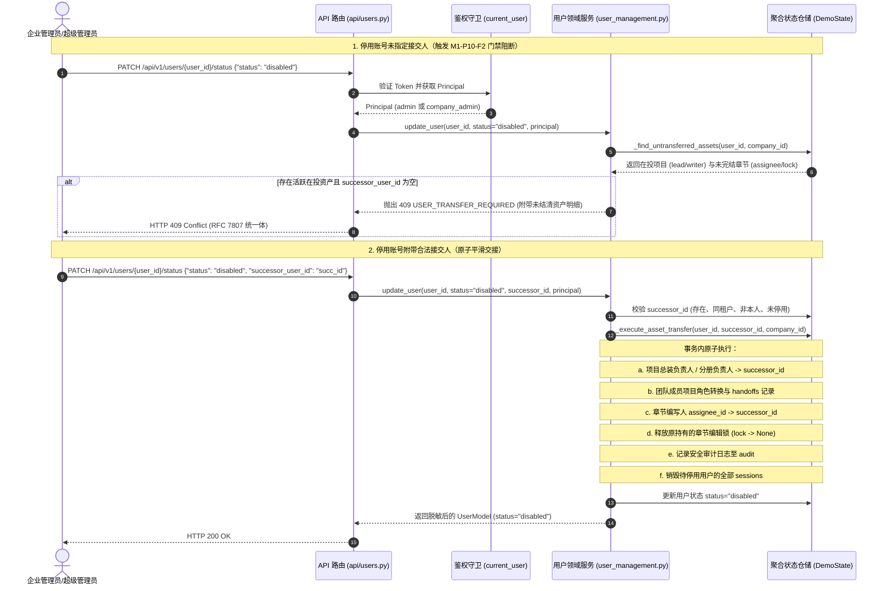

# BE-USER-MANAGEMENT-TRANSFER 代码说明：用户管理与账号停用前业务资产强制交接服务

为什么有这个文件：记录后端核心工单 BE-USER-MANAGEMENT-TRANSFER（用户管理与账号停用前业务资产强制交接服务）的技术架构、时序流、核心算法实现与自动化测试覆盖映射。

它解决什么问题：
1. 阐明用户管理领域模型（`UserModel`、`CreateUserRequest`、`UpdateUserStatusRequest`）与脱敏输出设计；
2. 详解 Q28 定案密码强度校验（最少 8 位且至少包含大写、小写、数字、符号中的三类）与 PBKDF2-HMAC-SHA256 加盐哈希加密机制；
3. 详解原型 §6.2 M1-P10-F2 停用前资产探测与强制交接门禁算法（`USER_TRANSFER_REQUIRED`）；
4. 阐明在投项目责任、分册责任、章节编写人与编辑锁的原子平滑交接算法；
5. 记录多租户隔离与 8 角色 RBAC 细粒度权限控制防线。

---

## 1. 系统架构与交互时序



---

## 2. 核心算法与业务逻辑实现

### 2.1 密码强度校验算法（Q28 定案）

在 [`backend/bid-core/icg/domain/auth_service.py`](../../backend/bid-core/icg/domain/auth_service.py) 中实现：

```python
def validate_password_strength(password: str, min_length: int = 8, min_classes: int = 3) -> tuple[bool, str]:
    if not password or len(password) < min_length:
        return False, f"密码长度不能低于平台下限 {min_length} 位。"
    classes = 0
    if any(c.isupper() for c in password):
        classes += 1
    if any(c.islower() for c in password):
        classes += 1
    if any(c.isdigit() for c in password):
        classes += 1
    if any(not c.isalnum() for c in password):
        classes += 1
    if classes < min_classes:
        return False, f"须包含大写字母、小写字母、数字、特殊符号中的至少 {min_classes} 类。"
    return True, ""
```

若校验失败，抛出统一错误码：
```python
raise DomainError(422, "PASSWORD_WEAK", f"密码强度不足：{msg}", details={"field": "password"})
```

### 2.2 待停用用户在投资产探测算法

在 [`backend/bid-core/icg/domain/user_management.py`](../../backend/bid-core/icg/domain/user_management.py) 中，对同企业未归档（`not project.is_archived`）的资产进行两层全量探测：

```python
def _find_untransferred_assets(self, user_id: str, company_id: str) -> tuple[list[dict], list[dict]]:
    state = self.repository.state
    active_projects, active_chapters = [], []

    # 1. 扫描未归档项目中的负责人、分册负责人或团队编写人
    for p_id, project in state.projects.items():
        if project.company_id != company_id or project.is_archived:
            continue
        team = state.project_teams.get(p_id, {})
        is_lead = (
            team.get("assembly_owner_id") == user_id
            or any(owner == user_id for owner in team.get("owners", {}).values())
            or team.get("members", {}).get(user_id, {}).get("project_role") in ("lead", "project_lead")
        )
        is_writer = (
            not is_lead
            and team.get("members", {}).get(user_id, {}).get("project_role") in ("writer", "bid_writer")
        )
        if is_lead:
            active_projects.append({"project_id": p_id, "project_name": project.name, "role_in_project": "lead"})
        elif is_writer:
            active_projects.append({"project_id": p_id, "project_name": project.name, "role_in_project": "writer"})
        elif project.created_by == user_id:
            active_projects.append({"project_id": p_id, "project_name": project.name, "role_in_project": "creator"})

    # 2. 扫描未归档项目中由该用户负责编写或处于编辑锁定的章节
    for c_id, chapter in state.chapters.items():
        proj = state.projects.get(chapter.project_id)
        if not proj or proj.company_id != company_id or proj.is_archived:
            continue
        is_assigned = (chapter.assignee_id == user_id)
        is_locked = (chapter.lock is not None and getattr(chapter.lock, "user_id", None) == user_id)
        if is_assigned or is_locked:
            active_chapters.append({
                "chapter_id": c_id,
                "project_id": chapter.project_id,
                "title": chapter.title,
                "volume": chapter.volume,
                "is_assigned": is_assigned,
                "is_locked": is_locked,
            })

    return active_projects, active_chapters
```

### 2.3 原子资产平滑交接与会话作废机制

在单一仓储事务中执行全量职责转移：
1. **项目职责转移**：总装负责人 `assembly_owner_id`、分册负责人 `owners[volume]`、创建人 `created_by` 全部切换至接交人；原负责人团队成员权限转为 `readonly`；生成 `handoffs` 履历；
2. **章节职责转移与锁释放**：未归档项目中章节 `assignee_id` 重分配给接交人；若持有排他编辑锁，原子置为 `None` 安全释放；
3. **安全审计留痕**：在 `state.audit` 追加 `user.deactivate_and_transfer` 操作记录，留存原操作人、接交双方与转交资产列表；
4. **会话即时作废**：清理 `state.sessions` 中被停用用户的全部 Token，原 Token 再次请求严格拦截 401 `UNAUTHENTICATED`，重新登录拦截 401 `INVALID_CREDENTIALS`。

---

## 3. 错误码与 HTTP 映射表

| 错误码（Code） | HTTP 状态码 | 业务场景与触发条件 |
|---|---|---|
| `PASSWORD_WEAK` | 422 Unprocessable Entity | 新建用户初始密码不足 8 位，或包含的字符类别数少于 3 类 |
| `DICT_CODE_DUPLICATED` | 409 Conflict | 新建用户账号名 `username` 已在系统中存在 |
| `USER_TRANSFER_REQUIRED` | 409 Conflict | 停用持有在投资产（项目负责人/编写人/锁定章节）的用户且未指定合法接交人 |
| `NOT_FOUND` | 404 Not Found | 调阅或修改不存在的用户，或非超级管理员跨公司访问其他企业用户 |
| `FORBIDDEN` | 403 Forbidden | 普通角色尝试执行写操作，或尝试停用全系统超级管理员 `admin` |
| `VALIDATION_ERROR` | 422 Unprocessable Entity | 接交人与被停用人相同、接交人属于外企业、或接交人账号已被停用 |
| `UNAUTHENTICATED` | 401 Unauthorized | 账号停用后原会话被销毁，使用原 Token 访问接口 |
| `INVALID_CREDENTIALS` | 401 Unauthorized | 已停用的账号尝试使用用户名密码登录认证 |

---

## 4. 自动化测试用例覆盖映射

测试源码：[`tests/backend/test_user_management_transfer.py`](../../tests/backend/test_user_management_transfer.py)

| 测试函数名称 | 验证的核心业务规则 | 预期结果与断言 |
|---|---|---|
| `test_user_crud_and_password_policy` | 密码长度/类别校验、加盐哈希存储、重复账号拦截、登录验证 | 弱密码拦截 422 `PASSWORD_WEAK`，重复拦截 409 `DICT_CODE_DUPLICATED`，合格创建 201 且登录成功 |
| `test_multi_tenant_and_rbac_isolation` | 普通成员写拦截、跨租户访问 404 隔离、超管全平台查询、超管 admin 免停用保护 | 普通写返回 403，跨企返回 404，停用 admin 返回 403 |
| `test_disable_user_without_transfer_blocked_by_user_transfer_required` | 核心红线 M1-P10-F2：绑定未归档项目或锁定章节未转交禁止停用 | 严格拦截 409 `USER_TRANSFER_REQUIRED`，且 details 携带在投资产明细 |
| `test_disable_user_with_invalid_successor_rejected` | 非法接交人拦截防御（不存在、本人、跨企业、已停用） | 不存在返回 404 `NOT_FOUND`，本人/跨企业返回 422 `VALIDATION_ERROR` |
| `test_disable_user_with_valid_successor_atomic_handoff` | 合法接交人原子平滑交接在投项目、章节责任、释放编辑锁、会话销毁、审计留存 | 返回 200，状态 disabled，各职责转移至接交人，编辑锁释放，原 Token 变 401，登录变 401 |
| `test_archived_project_does_not_block_deactivation` | 已归档历史项目不阻断停用 | 仅有名下归档项目的用户可直接停用成功返回 200 |
| `test_independent_transfer_endpoint` | 独立资产转交端点 `POST /api/v1/users/{user_id}/transfer` | 返回 200，success=True，资产完成平滑交接 |
