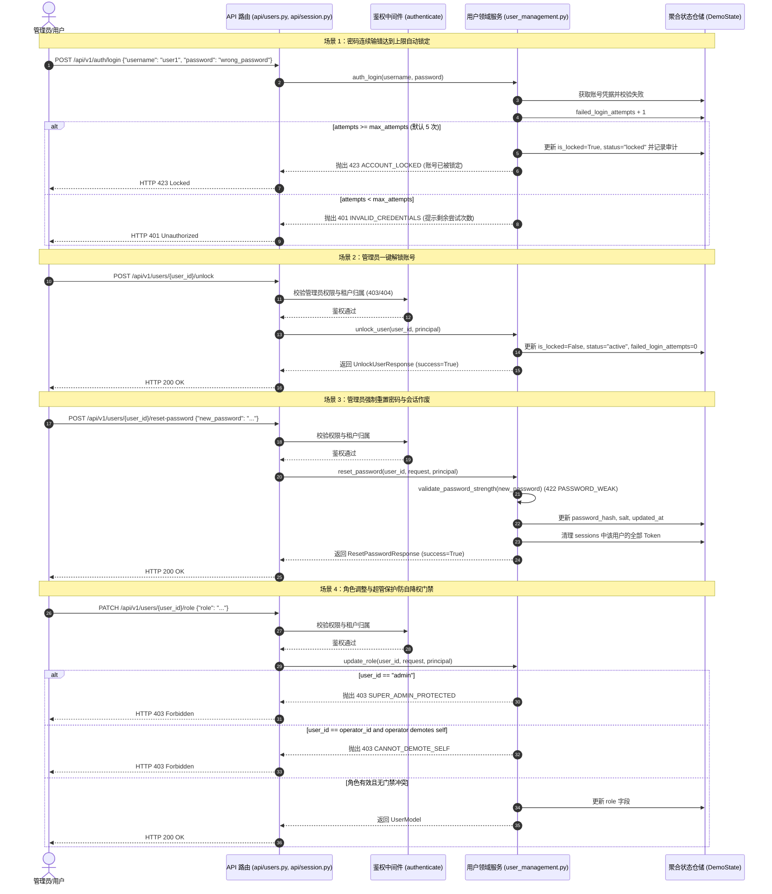

# BE-USER-SECURITY-OPS 代码说明：用户角色调配、密码强制重置与登录失败锁定/解锁服务

为什么有这个文件：记录后端核心工单 BE-USER-SECURITY-OPS（用户角色调配、密码强制重置与登录失败锁定/解锁服务）的技术架构、时序图、核心业务门禁算法实现与自动化测试覆盖映射。

它解决什么问题：
1. 阐明密码强制重置端点（`reset_password`）与 Q28 密码安全策略校验、加盐哈希更新及活跃会话即时作废机制；
2. 详解连续登录失败计数（`failed_login_attempts`）、阈值判定、自动锁定（423 `ACCOUNT_LOCKED`）及管理员一键解锁端点（`unlock_user`）实现细节；
3. 详解角色调配端点（`update_role`）及其双重安全门禁：系统超管保护门禁（403 `SUPER_ADMIN_PROTECTED`）与管理员防自降权门禁（403 `CANNOT_DEMOTE_SELF`）；
4. 记录多租户强隔离（404 `NOT_FOUND`）与 8 角色细粒度 RBAC 鉴权架构；
5. 建立专属自动化测试套件与契约零漂移核验映射。

---

## 1. 系统架构与交互时序



---

## 2. 核心算法与业务逻辑实现

### 2.1 连续登录失败自动锁定机制

在 [`backend/bid-core/icg/domain/domain.py`](../../backend/bid-core/icg/domain/domain.py) 的 `auth_login` 中实现：
```python
        if not valid:
            attempts = getattr(user, "failed_login_attempts", 0) + 1
            max_attempts = 5
            if hasattr(self, "company_settings_service") and self.company_settings_service and user.company_id:
                st = getattr(self.company_settings_service, "_store", {}).get(user.company_id)
                if st and getattr(st, "max_login_attempts", None):
                    max_attempts = st.max_login_attempts
            is_now_locked = (attempts >= max_attempts)

            def record_failure(s: DemoState):
                u = s.accounts.get(username)
                if u:
                    if is_now_locked:
                        s.accounts[username] = replace(u, failed_login_attempts=attempts, is_locked=True, status="locked", updated_at=time.time())
                        s.audit.append({"action": "user.locked", "user_id": username, "attempts": attempts, "timestamp": time.time()})
                    else:
                        s.accounts[username] = replace(u, failed_login_attempts=attempts, updated_at=time.time())

            self.repository.transaction(record_failure)

            if is_now_locked:
                raise DomainError(423, "ACCOUNT_LOCKED", f"密码连续错误达到上限（{max_attempts}次），账号已被锁定，请联系管理员解锁。")
            else:
                raise DomainError(401, "INVALID_CREDENTIALS", f"用户名或密码错误，还剩 {max_attempts - attempts} 次尝试机会。")
```

### 2.2 密码重置与会话作废算法

在 [`backend/bid-core/icg/domain/user_management.py`](../../backend/bid-core/icg/domain/user_management.py) 中实现：
```python
    def reset_password(
        self,
        user_id: str,
        request: ResetPasswordRequest,
        principal: Principal,
    ) -> ResetPasswordResponse:
        """重置用户密码，执行 Q28 密码安全策略并即时作废该用户所有活跃会话。"""
        # 1. 租户隔离与 RBAC 权限校验 (403/404)
        ...
        # 2. Q28 密码强度策略校验 (422 PASSWORD_WEAK)
        validate_password_strength(request.new_password)

        from icg.domain.auth_service import hash_password
        p_hash, p_salt = hash_password(request.new_password)
        now_ts = time.time()

        def _do_reset(st):
            target = st.accounts.get(user_id)
            if not target:
                raise DomainError(404, "NOT_FOUND", f"用户 {user_id} 不存在。")
            updated = replace(target, password_hash=p_hash, salt=p_salt, is_locked=False, status="active", failed_login_attempts=0, updated_at=now_ts)
            st.accounts[user_id] = updated
            # 立即作废该用户全部活跃会话
            tokens_to_revoke = [tok for tok, uid in st.sessions.items() if uid == user_id]
            for tok in tokens_to_revoke:
                del st.sessions[tok]
            st.audit.append({"action": "user.reset_password", "operator": user.id, "target_user_id": user_id, "timestamp": now_ts})

        self.repository.transaction(_do_reset)
        return ResetPasswordResponse(success=True, user_id=user_id, message=f"已成功重置用户 {user_id} 的密码并销毁其全部活跃登录会话。")
```

### 2.3 角色调整双重安全门禁（超管保护与管理员防自降权）

在 [`backend/bid-core/icg/domain/user_management.py`](../../backend/bid-core/icg/domain/user_management.py) 中实现：
```python
    def update_role(
        self,
        user_id: str,
        request: UpdateUserRoleRequest,
        principal: Principal,
    ) -> UserModel:
        """调整用户角色，执行超管保护与管理员防自降权门禁。"""
        user = principal.user
        acc = self.repository.read().accounts.get(user_id)
        if not acc:
            raise DomainError(404, "NOT_FOUND", f"用户 {user_id} 不存在。")

        # 1. 租户隔离与 RBAC 权限校验
        if not is_super_admin(user):
            if acc.company_id != user.company_id:
                raise DomainError(404, "NOT_FOUND", f"用户 {user_id} 不存在或当前账号无权访问。")
            norm_role = ROLE_NORMALIZATION_MAP.get(user.role, user.role)
            if norm_role != ROLE_COMPANY_ADMIN:
                raise DomainError(403, "FORBIDDEN", "只有企业管理员或平台管理员可分配用户角色。")

        # 2. 超管 admin 保护门禁（SUPER_ADMIN_PROTECTED 403）
        if user_id == "admin":
            raise DomainError(403, "SUPER_ADMIN_PROTECTED", "系统超级管理员 admin 角色受到保护，不可被修改或降权。")

        # 3. 管理员防自降权门禁（CANNOT_DEMOTE_SELF 403）
        if user_id == user.id:
            norm_curr = ROLE_NORMALIZATION_MAP.get(user.role, user.role)
            norm_target = ROLE_NORMALIZATION_MAP.get(request.role, request.role)
            if norm_curr in (ROLE_COMPANY_ADMIN, "platform_admin") and norm_target != norm_curr:
                raise DomainError(403, "CANNOT_DEMOTE_SELF", "管理员账号不能对自己进行降权操作，请由其他管理员执行。")

        # 4. 目标角色合法性校验
        if request.role not in ROLE_NORMALIZATION_MAP:
            raise DomainError(422, "VALIDATION_ERROR", f"目标角色 {request.role} 不合法。")

        now_ts = time.time()
        def _do_update(st):
            target = st.accounts.get(user_id)
            if not target:
                raise DomainError(404, "NOT_FOUND", f"用户 {user_id} 不存在。")
            updated = replace(target, role=request.role, updated_at=now_ts)
            st.accounts[user_id] = updated
            st.audit.append({"action": "user.update_role", "operator": user.id, "target_user_id": user_id, "new_role": request.role, "timestamp": now_ts})

        self.repository.transaction(_do_update)
        updated_acc = self.repository.read().accounts.get(user_id)
        return account_to_user_model(updated_acc)
```

---

## 3. 测试覆盖与验证矩阵

测试文件：[`tests/backend/test_user_security_ops.py`](../../tests/backend/test_user_security_ops.py)

| 测试用例函数 | 覆盖场景 | 验证断言 |
|---|---|---|
| `test_password_reset_and_policy_enforcement` | 密码重置与安全策略 | 弱密码（不足8位、不足3类）拦截 422 `PASSWORD_WEAK`；普通成员越权重置拦截 403 `FORBIDDEN`；跨企业管理员重置拦截 404 `NOT_FOUND`；合法重置成功 200 OK；原 Token 即时失效 401；旧密码登录失败 401；新密码登录成功 200 |
| `test_account_lock_on_failed_logins_and_unlock` | 连续输错锁定与解锁 | 连续 4 次输错密码返回 401 并提示剩余次数；第 5 次输错密码触发 423 `ACCOUNT_LOCKED`；锁定后即使用正确密码亦被 423 拦截；锁定账号已有 Token 访问受限 401；普通成员越权解锁拦截 403 `FORBIDDEN`；跨企业企管解锁拦截 404 `NOT_FOUND`；本公司企管解锁 200 OK；解锁后正确密码登录成功 200 |
| `test_role_update_super_admin_protection_and_cannot_demote_self` | 角色分配与双门禁 | 调整普通用户角色为有效角色 200 OK；传入非法角色代码拦截 422 `VALIDATION_ERROR`；跨企业修改角色拦截 404 `NOT_FOUND`；尝试修改系统超管 admin 角色拦截 403 `SUPER_ADMIN_PROTECTED`；管理员自我降权拦截 403 `CANNOT_DEMOTE_SELF`；超管跨企业修改角色 200 OK |
