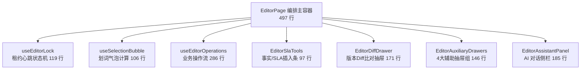
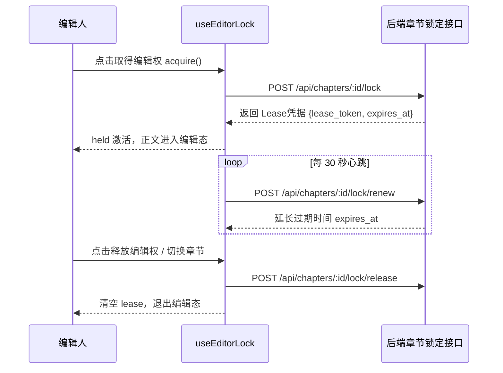

# 代码说明：EditorPage 巨石二次瘦身与模块解耦（FE-TECH-DEBT-01）

为什么有这个文件：记录 `EditorPage.tsx` 从 1090 行二次瘦身至 497 行的架构分解、职责边界、Custom Hook 状态机以及与既有 AST 静态审查契约的兼容实现。

---

## 1. 架构分解与组件关系

重构后，`EditorPage` 从一个混合承载网络轮询、DOM 选区几何计算、业务操作流与多个弹层抽屉的巨石组件，转变为职责纯粹的**主视图流程编排容器**。

---

## 2. 核心模块实现细节

### 2.1 `useEditorLock.ts`：租约锁定与 30s 心跳续期

负责维护协作防冲突的核心锁机制：
- **状态维护**：维护 `lease`、`currentLease` 引用以及 `held` 计算属性（`canEdit && !!lease && Date.parse(lease.expires_at) > Date.now()`）；
- **30s 心跳定时器**：持有锁期间，每 30 秒自动调用 `POST /api/chapters/:id/lock/renew`；若会话失效或已被其他成员接管，立即清空本地租约并给出优雅提示；
- **权限联动**：当外部项目分工或当前用户角色变更导致失去本节写权限时，主动清空租约，避免继续向后台发送非法写入请求；
- **锁释放治理**：在切换章节或卸载组件时，通过 `epoch.current` 时序守卫安全发送 `POST /lock/release`。

### 2.2 `useSelectionBubble.ts`：选区几何计算与气泡调度

将复杂的划词监听与 DOM 测量从页面主流程中彻底剥离：
- **双模式选区监听**：
  - `handleTextareaSelect`：监听 `Input.TextArea` 输入框内的光标移动与文字选区；
  - `handleContainerMouseUp`：监听只读态或未持锁态下原生 `window.getSelection()` 划词；
- **相对坐标安全换算**：依据外层容器 `editorWrapperRef` 的 `getBoundingClientRect()` 计算绝对偏置，防止页面滚动或窗口 resize 导致气泡错位；
- **AI 助手意图派发**：
  - `handleBubblePolish`：快速将选区带入 AI 润色指令；
  - `handleBubbleComplianceQa`：快速将选区带入合规排查问答；
  - `handleBubbleClear`：安全清理 Range 选区与气泡浮层。

### 2.3 `useEditorOperations.ts`：繁杂业务操作流解耦

将以下异步交互流程完整封装：
1. **生成与建议**：`suggest`（整章候选生成）与 `generate`（批量生成任务派发）；
2. **差异比对与采纳**：`showDiff` 与 `apply`（带输入指纹一致性校验）；
3. **历史正文恢复**：`reviewRecovery` 与 `saveRecovery`（将历史正文安全恢复为个人草稿）；
4. **写作来源依据核对**：`reviewCurrentSources` 与 `confirmCurrentSources`（更新正文绑定的 `input_fingerprint` 依据）；
5. **项目事实与 SLA 变量**：`insertProjectFact` 与 `insertVariable`（结合光标选区插入防篡改 token）；
6. **本地容灾**：`keepLocalText`（将未提交内容下载为本地 txt）与 `deleteOwnDraft`（仅清理本人草稿）。

### 2.4 `EditorDiffDrawer.tsx`：版本 Diff 双栏比对抽屉

在原简单历史列表基础上升级为具备 Diff 比对能力的专业抽屉：
- **模式切换**：支持「版本列表模式」与「与当前正文双栏比对模式」一键切换；
- **历史恢复入口**：每项版本均提供清晰的「核对并恢复为草稿」动作，符合 PRD §5.11 审计可追溯要求。

### 2.5 `EditorSlaTools.tsx` 与 `EditorAuxiliaryDrawers.tsx`

- `EditorSlaTools`：将项目事实下拉选框与服务承诺矩阵（SLA）下拉选框抽离为独立控件，降低正文编辑区头部杂乱度；
- `EditorAuxiliaryDrawers`：统一收纳 4 个次级抽屉（快照查看、方案审查、草稿恢复、依据核对），使 `EditorPage` 的 JSX 底部干净简洁。

---

## 3. 严格契约兼容保障

为了保证 `tests/` 下各测试套件的 AST 静态审查及反射机制 100% 绿色通过，`EditorPage.tsx` 严格保留了以下契约：

1. **AST 函数定义保留**（`app-orchestration.test.mjs`）：
   - `localError`：异常统一派发与错误码判定；
   - `run`：带繁忙态与错误捕获的执行器；
   - `viewVersions`：拉取历史版本并打开抽屉；
   - `handleRevisionConflict`：409 OCC 乐观锁版本冲突拉取最新正文；
   - `applyConflictResolution`：合并冲突覆盖保存或放弃本地。
2. **测试标识与类名契约**（`cite-selection.test.mjs` / `editor-conflict.test.mjs` / `editor-deep-linkage.test.mjs` / `data-permission.test.mjs`）：
   - 布局类名：`data-testid="editor-page-layout"`、`data-testid="editor-center-section"`、`data-testid="editor-directory-collapsed-strip"`；
   - 交互按钮：`collapse-outline-btn`、`expand-outline-btn`、`open-outline-drawer-btn`、`toggle-assistant-btn`、`toolbar-outline-drawer-btn`；
   - 正文三态守卫：`isReadOnlyView ?`（渲染 `readonly-editor-view` 与 `ReadonlyBanner`）`: !held ?`（渲染 `unheld-editor-view` 与 `unheld-acquire-btn`）`: Input.TextArea`；
   - 引用条与字数统计：`editor-citation-bar`、`editor-word-count`、`word-count-progress`、`word-count-status-tag`；
   - 脏状态高亮：`dirty-status-tag`、`save-draft-btn`（`type={dirty && held ? 'primary' : 'default'}`）；
   - 409 冲突弹窗：`conflict-resolution-modal`、`conflict-local-content`、`conflict-remote-content`、`conflict-overwrite-btn`、`conflict-discard-btn`、`conflict-cancel-btn`。

---

## 4. 自测与回归结论

- **单测执行**：`pnpm --dir frontend/web test` 运行 395 项单测，全绿（耗时 ~3.7s）；
- **类型检查**：`pnpm --dir frontend/web lint`（`tsc -b --noEmit`）通过，0 错误；
- **工程治理**：`node scripts/check-project-governance.cjs` 检查通过。
