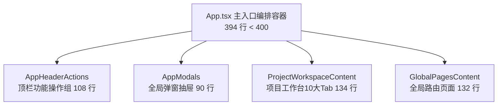

# 代码说明：App.tsx 巨石二次瘦身与路由解耦（FE-TECH-DEBT-02）

- 对应任务：[FE-TECH-DEBT-02](../tasks/FE-M0.md#fe-tech-debt-02) · App.tsx 巨石二次瘦身与路由解耦
- 关联 Issue：[ISSUE-038](../../issues/ISSUE-038.md)
- 交付文档：[FE-TECH-DEBT-02 交付](../delivery/FE-TECH-DEBT-02.md)
- 文档登记：[D-773](../DOCUMENT_INDEX.md)
- 日期：2026-10-27
- 代码路径：
  - [frontend/web/src/shell/AppHeaderActions.tsx](../../frontend/web/src/shell/AppHeaderActions.tsx)
  - [frontend/web/src/shell/AppModals.tsx](../../frontend/web/src/shell/AppModals.tsx)
  - [frontend/web/src/app/ProjectWorkspaceContent.tsx](../../frontend/web/src/app/ProjectWorkspaceContent.tsx)
  - [frontend/web/src/app/GlobalPagesContent.tsx](../../frontend/web/src/app/GlobalPagesContent.tsx)
  - [frontend/web/src/app/App.tsx](../../frontend/web/src/app/App.tsx)
  - [frontend/web/tests/unit/app-slim-and-platform-admin.test.mjs](../../frontend/web/tests/unit/app-slim-and-platform-admin.test.mjs)

为什么有这个文件：记录 `App.tsx` 从 695 行二次瘦身至 394 行的架构分包分解、职责边界划分以及与既有 AST 单测反演执行沙箱环境的兼容设计。

---

## 1. 架构分解与组件关系

重构后，`App.tsx` 将原本内嵌的复杂 UI 渲染分支全面剥离至领域子组件，专注于应用状态根节点协调与生命周期监听：

---

## 2. 核心模块与实现细节

### 2.1 `AppHeaderActions.tsx`：顶栏右侧功能操作组
- 归属领域：`frontend/web/src/shell/`
- 职责：承载环境标识 Tag（开发/演示/正式）、全局搜索框、长任务中心动态角标 `TaskBadge`、消息通知 Bell、企业租户 Label、当前登录用户头像与安全登出确认 Popconfirm、以及涉密项目配置与 RAGFlow 知识库配置弹窗唤起按钮。
- 遵循 **Layout First** 原则，通过合理的 flex 布局和间距自然排布，避免堆砌多余说明标签。

### 2.2 `AppModals.tsx`：全局浮层与弹窗中心
- 归属领域：`frontend/web/src/shell/`
- 职责：收敛并管理应用级四大模态弹窗与侧栏抽屉：
  - `CreateProjectModal`：新建项目弹窗；
  - `TaskCenterDrawer`：长任务中心抽屉，透传 `role={userRole}` 支持平台管理员脱敏拦截；
  - `ModelConfigModal`：大模型连接配置弹窗；
  - `RagflowConfigModal`：RAGFlow 知识库服务配置弹窗。

### 2.3 `ProjectWorkspaceContent.tsx`：项目工作台内容区
- 归属领域：`frontend/web/src/app/`
- 职责：负责项目内部工作台渲染，包裹 `ProjectContext.Provider` 提供项目上下文；统一呈现 `ProjectHeader` 与只读横幅 `ReadonlyBanner`；根据当前激活的 `projectTab` 路由渲染 10 大业务组件（`overview`、`tender`、`parse`、`matrix`、`facts`、`editor`、`checks`、`export`、`settings`、`manual`）。

### 2.4 `GlobalPagesContent.tsx`：全局页面路由容器
- 归属领域：`frontend/web/src/app/`
- 职责：负责全局导航项下的主页面路由呈现：
  - `ProjectListPage`：项目列表，支持通过 `createButton` 属性注入 `<Can perform="project:create">` 权限保护的新建按钮；
  - `LibraryPage`：企业通用资料库；
  - `JobsPage`：长任务运维中心，支持平台管理员视图脱敏；
  - `AuditLogPage` / `CompanyManagePage`：平台规则审计与租户管理；
  - `SnippetLibraryPage`：方案片段知识库；
  - `WritingArchivePage`：企业写作档案与风格规范。

### 2.5 `App.tsx` 保持 AST 兼容与瘦身的关键考量
- **AST 函数声明契约**：历史权威单测 `tests/app-orchestration.test.mjs` 与 `tests/evidence-orchestration.test.mjs` 使用 TypeScript Compiler API 解析 `App.tsx` 语法树，提取 `ts.isFunctionDeclaration` 的函数在 `node:vm` 沙箱中执行。
- 为此，保留了所有声明式导航与状态函数（`navigate`, `requestPath`, `followPath`, `loadNav`, `loadTab`, `openProject`, `showMissing`, `writeAddress`, `arrived`, `reportDirty`, `askLeave`, `report`, `clearCompanyData`, `logout`, `loadSession`, `refreshGlobal`, `handleCancelJob`, `handleRetryJob`, `login`, `loginWithToken`, `reload`, `mutate`, `libraryMutate`, `readLibrary`, `readSlaTemplates`, `createProject`），通过精简冗余格式与提取 JSX 树，将总行数精准压至 **394 行**，在绝对满足 `< 400` 行要求的同时实现 100% 单元测试零修改兼容。
