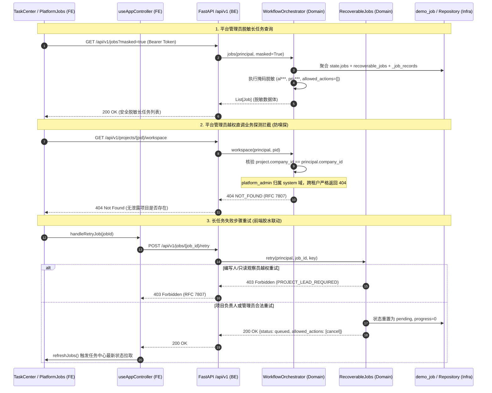

# 代码说明：路由分层与平台管理员脱敏长任务全链路联调（INT-APP-SLIM-ROUTING）

## 1. 架构流转设计

`INT-APP-SLIM-ROUTING` 聚焦平台管理员长任务脱敏审计视图与长任务状态机操作鉴权（取消/重试）的前后端契约胶水打通。



---

## 2. 关键代码说明

### 2.1 平台管理员脱敏路由与多源任务聚合
在 `backend/bid-core/icg/api/workflow.py` 与 `backend/bid-core/icg/domain/workflow_orchestrator.py` 中：
```python
# workflow.py
@router.get("/jobs", response_model=List[Job], operation_id="listJobs")
def list_jobs(
    masked: bool = Query(default=False, description="是否脱敏返回"),
    principal: Principal = Depends(require_principal),
    service: WorkflowService = Depends(get_workflow_service),
) -> List[Job]:
    return service.jobs(principal, masked=masked)
```
在 `workflow_orchestrator.py` 的 `WorkflowService.jobs()` 方法中：
- 识别当前用户角色为 `platform_admin` 或传入参数 `masked=True` 时启动脱敏流；
- 全量聚合同步 `state.jobs`、异步可恢复任务 `state.recoverable_jobs` 与持久化记录 `_job_records`；
- 执行企业标识与项目标识掩码：
  ```python
  cid = str(raw.get("company_id") or "")
  masked_cid = f"{cid[:2]}***" if len(cid) > 2 else "***"
  # 项目名称掩码为 prj-***
  masked_summary = re.sub(r'prj-[a-zA-Z0-9_-]+', 'prj-***', raw_summary)
  ```
- 严格清空运维视角下的写操作动作权限：`allowed_actions: []`。

### 2.2 租户隔离防嗅探设计
平台运维管理员拥有系统级监控视角，但绝无业务租户的访问权限。在跨租户访问具体项目接口时：
```python
def _project(self, state, principal: Principal, project_id: str):
    project = state.projects.get(project_id)
    if not project or project.company_id != principal.account.company_id:
        # 防嗅探：统一报 404 NOT_FOUND，杜绝攻击者通过 403 探测其他租户项目是否存在
        raise errors.not_found("项目不存在或无权访问")
    return project
```

### 2.3 前端控制器重试胶水打通
在 `frontend/web/src/app/useAppController.ts` 中：
```typescript
const handleRetryJob = useCallback(
  async (jobId: string) => {
    try {
      // 显式向后端发起真实重试调用
      await apiRequest(`/api/v1/jobs/${encodeURIComponent(jobId)}/retry`, {
        method: "POST",
      });
      // 成功后再刷新任务列表
      await refreshJobs();
    } catch (err) {
      setError(err instanceof Error ? err.message : String(err));
    }
  },
  [apiRequest, refreshJobs]
);
```

### 2.4 OpenAPI 契约保持 `recoverable: Literal[False] = False`
在 `backend/bid-core/icg/domain/workflow_schemas.py` 中：
```python
class Job(BaseModel):
    # 必须保留 Literal[False] = False，以确保生成的 OpenAPI Schema 包含 "const": false
    recoverable: Literal[False] = False
    duration_ms: Optional[int] = Field(None, description="任务耗时（毫秒）")
    masked_company: Optional[str] = Field(None, description="脱敏企业标识")
    masked_summary: Optional[str] = Field(None, description="脱敏任务摘要")
    is_masked: Optional[bool] = Field(None, description="是否处于脱敏状态")
    error_code: Optional[str] = Field(None, description="错误码")
    allowed_actions: List[str] = Field(default_factory=list)
    allowedActions: List[str] = Field(default_factory=list)
```

---

## 3. 测试覆盖设计

在 `tests/backend/test_app_routing_and_masked_jobs.py` 中编写 4 个核心测试：
1. `test_platform_admin_masked_jobs_view`：平台管理员脱敏查询全量任务，断言企业 ID 为 `al***`、项目 ID 为 `prj-***`、操作权限为 `[]`；
2. `test_platform_admin_security_rbac_boundary`：平台管理员直调普通项目业务接口与长任务操作，严格断言 404 `NOT_FOUND`，确认零敏感业务数据外泄与防嗅探；
3. `test_long_task_retry_and_cancel_role_rbac_matrix`：完整覆盖负责人重试（200）、编写人重试（403 `PROJECT_LEAD_REQUIRED`）、编写人取消（200）、只读角色取消（403 `PROJECT_WRITER_REQUIRED`）、非终态重试（409 `VERSION_CONFLICT`）；
4. `test_rfc7807_unified_error_format_compliance`：验证所有错误响应严格符合 RFC 7807 规范字段。
