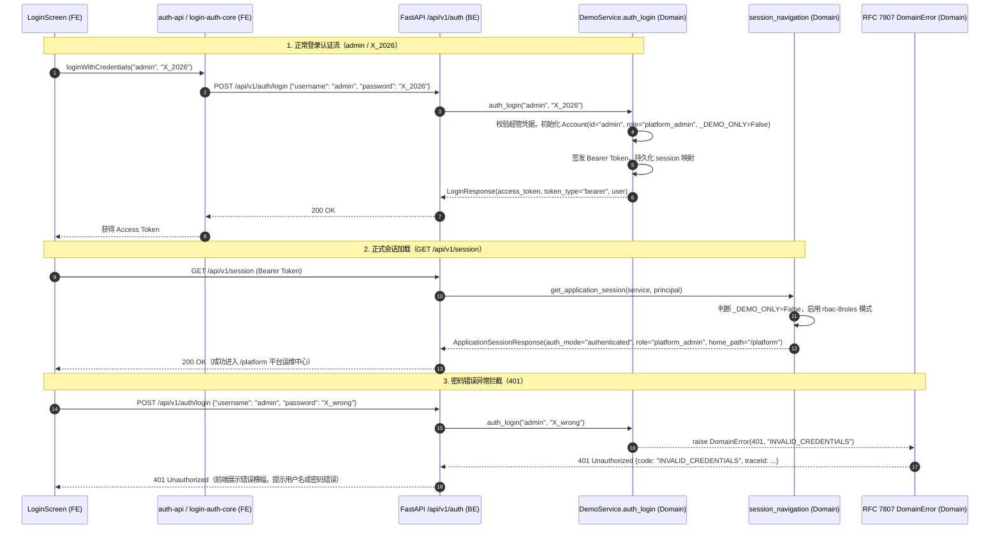

# 代码说明：账号密码认证与超级管理员端到端契约联调（INT-AUTH-LOGIN-RBAC-GLUE）

## 1. 架构流转设计

`INT-AUTH-LOGIN-RBAC-GLUE` 负责打通非演示模式下基于账号密码凭据认证（`LoginScreen.tsx` / `login-auth-core.ts`）与后端 `/api/v1/auth/login` 之间的端到端契约胶水层，确保超级管理员全权限导航会话与系统级能力生效：



---

## 2. 关键代码说明

### 2.1 错误码冻结与登记 (`backend/bid-core/icg/domain/errors.py`)
在 HTTP 401 状态码组中新增登记 `INVALID_CREDENTIALS`：
```python
    _bind(table, 401, ("UNAUTHENTICATED", "INVALID_ACCOUNT", "INVALID_CREDENTIALS"))
```
状态语义唯一绑定为 401，由 FastAPI 异常处理器包装为 RFC 7807 统一错误体。

### 2.2 登录请求数据契约 (`backend/bid-core/icg/domain/schemas.py`)
```python
class UsernamePasswordLoginRequest(RequestBody):
    username: str = Field(min_length=1, max_length=100, description="登录用户名")
    password: str = Field(min_length=1, max_length=128, description="登录密码")
```
继承自 `RequestBody`，自动启用 `strict=True` 与 `extra="forbid"`，拒绝任何未声明的冗余字段。

### 2.3 认证领域逻辑实现 (`backend/bid-core/icg/domain/domain.py`)
在 `DemoService` 中落地 `auth_login`：
```python
    def auth_login(self, username: str, password: str) -> dict:
        def operation(state: DemoState):
            if not username or not password:
                raise DomainError(401, "INVALID_CREDENTIALS", "用户名或密码错误，请核实后重试。")

            user = state.accounts.get(username)
            if user is None and username == "admin":
                from icg.domain.auth_service import hash_password
                p_hash, p_salt = hash_password("X_2026")
                user = Account(
                    id="admin",
                    name="系统超级管理员",
                    company_id="system",
                    role="platform_admin",
                    _DEMO_ONLY=False,
                    password_hash=p_hash,
                    salt=p_salt,
                    display_name="系统超级管理员",
                )
                state.accounts["admin"] = user

            if user is None:
                raise DomainError(401, "INVALID_CREDENTIALS", "用户名或密码错误，请核实后重试。")

            from icg.domain.auth_service import verify_password
            if user.password_hash:
                valid = verify_password(password, user.password_hash, user.salt)
            else:
                valid = (password == "X_2026")

            if not valid:
                raise DomainError(401, "INVALID_CREDENTIALS", "用户名或密码错误，请核实后重试。")

            token = secrets.token_urlsafe(32)
            state.sessions[token] = user.id
            user_data = asdict(user)
            user_data["username"] = user.id
            user_data["display_name"] = user.display_name or user.name
            return {"access_token": token, "token_type": "bearer", "user": user_data}
        return self.repository.transaction(operation)
```

### 2.4 API 端点挂载 (`backend/bid-core/icg/api/session.py`)
```python
    @application.post(
        "/api/v1/auth/login",
        response_model=LoginResponse,
        operation_id="authLogin",
        summary="账号密码登录认证",
        description="正式非演示模式下基于账号密码凭据进行身份认证。支持超级管理员 admin（初始密码 X_2026）及已注册账号登录；凭据错误返回 401 INVALID_CREDENTIALS。",
        responses=v1_error_responses(401, 422, 500),
    )
    def auth_login(body: UsernamePasswordLoginRequest):
        return service.auth_login(body.username, body.password)
```

### 2.5 前端交互胶水层 (`frontend/web/src/shared/auth-api.ts`)
```typescript
export async function loginWithCredentials(
  username: string,
  password: string
): Promise<AuthLoginResponse> {
  return request<AuthLoginResponse>('/api/v1/auth/login', null, 'POST', {
    username: username.trim(),
    password,
  });
}
```

---

## 3. 测试覆盖说明

专属测试 `tests/backend/test_auth_login_rbac_glue.py` 覆盖：
1. `test_auth_login_super_admin_success`：超级管理员 admin / X_2026 登录签发 Token；
2. `test_auth_login_invalid_password_blocked_401`：错误密码拦截 401 `INVALID_CREDENTIALS`；
3. `test_auth_login_unknown_user_blocked_401`：未知账号拦截 401；
4. `test_super_admin_session_retrieval`：获取超级管理员正式导航会话与 `/platform` 入口；
5. `test_super_admin_system_capabilities`：核验脱敏全量长任务、字典管理写操作、合规规则全目录与跨租户运维审计；
6. `test_standard_account_password_login`：企业正式账号密码登录与工作台会话加载。
