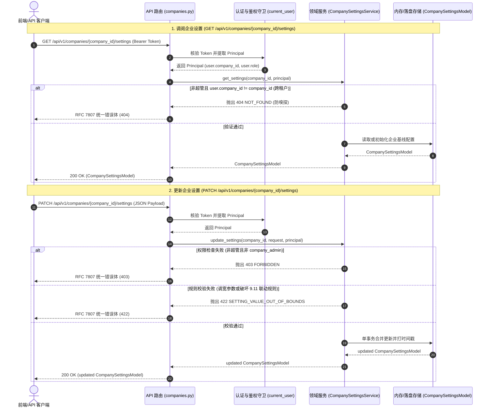

# INT-COMPANY-SETTINGS-RBAC-GLUE 代码说明：企业设置与安全策略/租户隔离端到端契约联调

为什么有这个文件：记录前後端联调工单 INT-COMPANY-SETTINGS-RBAC-GLUE（企业设置与安全策略/租户隔离端到端契约联调）的技术设计、代码架构、错误码注册、核心算法实现与测试覆盖映射。

它解决什么问题：
1. 阐明企业设置与安全策略领域模型（CompanySettingsModel）与路由胶水架构；
2. 详解“企业设置只能调严不能调宽”安全基线与规范 9.11 编辑锁三元联动规则的校验算法；
3. 阐明多租户数据强隔离与 8 大标准 RBAC 角色的权限感知防线；
4. 记录前后端契约对齐、OpenAPI 零漂移规范及自动化测试验证映射。

---

## 1. 系统架构与交互时序



---

## 2. 核心领域逻辑与安全红线算法

### 2.1 错误码冻结与登记

在 `backend/bid-core/icg/domain/errors.py` 中向 HTTP 422 绑定冻结错误码 `"SETTING_VALUE_OUT_OF_BOUNDS"`，并在 `frozen_error_codes.py` 按严格字母序插入：

```python
# backend/bid-core/icg/domain/errors.py
_bind(table, 422, (
    ...,
    "TWO_VOLUMES_REQUIRED",
    # 企业设置与安全策略越界校验 (APP-M2-T025 / PRD v1.8 §5.10.2 / §6.9)
    "SETTING_VALUE_OUT_OF_BOUNDS",
))
```

### 2.2 “只能调严不能调宽”安全基线校验算法

在 `backend/bid-core/icg/domain/company_settings.py` 中，定义平台基线与上下限常量，针对所有关键参数执行单向严格校验：

1. **密码最少位数（`password_min_length`）**：
   - 只能调严（>= 8），上限 32；低于 8 抛出 422 `SETTING_VALUE_OUT_OF_BOUNDS`；
2. **密码字符类别数（`password_min_char_classes`）**：
   - 只能调严（>= 3 类），上限 4 类（大写、小写、数字、符号）；低于 3 类抛出 422 `SETTING_VALUE_OUT_OF_BOUNDS`；
3. **连续登录失败锁定次数（`max_login_attempts`）**：
   - 只能调严（<= 5 次），下限 1 次；超过 5 次抛出 422 `SETTING_VALUE_OUT_OF_BOUNDS`；
4. **编辑锁租约超时时长（`edit_lock_timeout_minutes`）**：
   - 只能调严（<= 60 分钟），且必须大于释放提醒阈值 5 分钟（最少 6 分钟）；超过 60 分钟或 <= 5 分钟抛出 422 `SETTING_VALUE_OUT_OF_BOUNDS`；
5. **编辑锁心跳间隔（`edit_lock_heartbeat_seconds`）**：
   - 范围 15～120 秒；越界抛出 422 `SETTING_VALUE_OUT_OF_BOUNDS`；
6. **自动保存间隔（`editor_autosave_seconds`）**：
   - 范围 5～60 秒；越界抛出 422 `SETTING_VALUE_OUT_OF_BOUNDS`；
7. **章节生成循环轮数（`loop_max_rounds`）**：
   - 只能调严（<= 5 轮），下限 1 轮；超过 5 轮抛出 422 `SETTING_VALUE_OUT_OF_BOUNDS`；
8. **修改样例条数（`assistant_suggestion_count`）**：
   - 范围 3～5 条；越界抛出 422 `SETTING_VALUE_OUT_OF_BOUNDS`。

### 2.3 规范 9.11 编辑锁三元联动数学约束校验

依据 PRD v1.8 §5.11.9 与技术规范 9.11，编辑锁心跳续期与草稿自动保存具有强协同关系：
1. `editor_autosave_seconds <= edit_lock_heartbeat_seconds`：
   自动保存间隔不能大于心跳续期周期，否则会出现内容落盘前锁已释放的脏读险情；
2. `edit_lock_heartbeat_seconds * 10 <= edit_lock_timeout_minutes * 60`：
   心跳周期的 10 倍不得超过租约总时长，确保在网络抖动或丢包时至少有 10 次心跳重试窗口，防止意外锁失效。

```python
eff_autosave = request.editor_autosave_seconds if request.editor_autosave_seconds is not None else current.editor_autosave_seconds
eff_heartbeat = request.edit_lock_heartbeat_seconds if request.edit_lock_heartbeat_seconds is not None else current.edit_lock_heartbeat_seconds
eff_timeout = request.edit_lock_timeout_minutes if request.edit_lock_timeout_minutes is not None else current.edit_lock_timeout_minutes

if eff_autosave > eff_heartbeat:
    raise DomainError(
        422,
        "SETTING_VALUE_OUT_OF_BOUNDS",
        f"自动保存间隔（{eff_autosave}秒）不能大于编辑锁心跳间隔（{eff_heartbeat}秒）。",
    )

if eff_heartbeat * 10 > eff_timeout * 60:
    raise DomainError(
        422,
        "SETTING_VALUE_OUT_OF_BOUNDS",
        f"编辑锁心跳间隔的 10 倍（{eff_heartbeat * 10}秒）不能超过锁超时总时长（{eff_timeout * 60}秒）。",
    )
```

---

## 3. 多租户强隔离与 RBAC 权限控制实现

在 `CompanySettingsService` 中：
```python
def get_settings(self, company_id: str, principal: Principal) -> CompanySettingsModel:
    user = principal.user
    if not is_super_admin(user):
        if user.company_id != company_id:
            raise DomainError(404, "NOT_FOUND", f"未找到指定企业 {company_id} 或当前账号无权访问。")
    return self._get_or_create(company_id)

def update_settings(self, company_id: str, request: UpdateCompanySettingsRequest, principal: Principal) -> CompanySettingsModel:
    user = principal.user
    if not is_super_admin(user):
        if user.company_id != company_id:
            raise DomainError(404, "NOT_FOUND", f"未找到指定企业 {company_id} 或当前账号无权访问。")
        normalized_role = ROLE_NORMALIZATION_MAP.get(user.role, user.role)
        if normalized_role != ROLE_COMPANY_ADMIN:
            raise DomainError(403, "FORBIDDEN", "只有企业管理员或平台超级管理员可修改企业设置与安全策略。")
```

---

## 4. 前端类型化契约胶水层

在 `frontend/web/src/admin/company-settings-api.ts` 中封装：
- `fetchCompanySettings(companyId: string, token: string | null): Promise<ApiCompanySettings>`
- `updateCompanySettings(companyId: string, payload: ApiUpdateCompanySettingsPayload, token: string | null): Promise<ApiCompanySettings>`

严格调用核心 `request<T>(path, token, method, body)`，统一捕获并解析 RFC 7807 统一错误模型。

---

## 5. 自动化测试用例覆盖映射

在 `tests/backend/test_company_settings_rbac_glue.py` 与 `frontend/web/tests/unit/company-settings-api.test.mjs` 中构建完备用例：

| 测试用例函数 | 覆盖能力与业务场景 | 预期断言 |
|---|---|---|
| `test_unauthenticated_company_settings_blocked_401` | 未提供 Bearer Token 请求 GET / PATCH | HTTP 401，`code == "UNAUTHENTICATED"` |
| `test_super_admin_manage_any_company_settings` | 超管 admin 跨租户调阅 Alpha 与 Beta 并分别执行调严更新 | HTTP 200，字段成功更新，`updated_by == "admin"` |
| `test_company_admin_manage_own_company_settings` | Alpha 企管更新本企业编辑锁与助手参数 | HTTP 200，更新生效，`updated_by == "formal-alpha-admin"` |
| `test_cross_company_access_blocked_with_404` | Alpha 企管尝试读取与更新 Beta 企业配置（租户隔离红线） | 严格 HTTP 404 `NOT_FOUND`，无企业信息泄露 |
| `test_same_company_non_admin_cannot_patch_settings` | Alpha 投标编写人读写本公司设置 | GET 返回 200（只读允许），PATCH 拦截 403 `FORBIDDEN` |
| `test_setting_bounds_tighten_only_rules` | 密码长度<8、密码类数<3、登录重试>5、锁超时>60、自动保存>心跳、心跳*10>锁超时等10维越界测试 | 严格 HTTP 422 `SETTING_VALUE_OUT_OF_BOUNDS`，合法调严 200 成功 |
| `frontend/company-settings-api.test.mjs` | 前端导出签名、标准路径、URI 编码防注入与接口字段契约 | 测试断言 100% 通过 |
