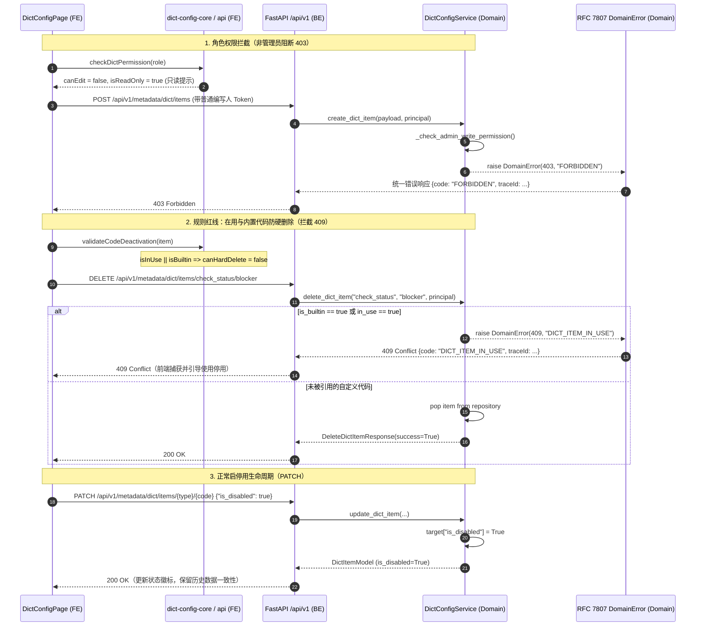

# 代码说明：字典配置与元数据停用/角色权限端到端契约联调（INT-DICT-CONFIG-RBAC-GLUE）

## 1. 架构流转设计

`INT-DICT-CONFIG-RBAC-GLUE` 负责打通前端字典配置视图（`DictConfigPage.tsx` / `dict-config-core.ts`）与后端 `/api/v1/metadata/dict/*` 之间的端到端契约胶水层，严格落地安全红线门禁与 8 角色权限核验：



---

## 2. 关键代码说明

### 2.1 错误码冻结与登记 (`backend/bid-core/icg/domain/errors.py`)
在 HTTP 409 状态码组中，新增登记了 `DICT_ITEM_IN_USE` 与 `DICT_CODE_DUPLICATED`：
```python
        # 字典配置与元数据停用/保护红线 (APP-M2-T024 / PRD v1.8 §5.10.3 / §6.9)
        "DICT_ITEM_IN_USE", "DICT_CODE_DUPLICATED",
```
根据系统架构约定，每一个业务错误代码严格绑定唯一的 HTTP 状态码，并在抛出 `DomainError(status, code, message, details)` 时执行强校验，由 FastAPI 全局异常处理器格式化为 RFC 7807 统一错误体。

### 2.2 字典配置领域服务 (`backend/bid-core/icg/domain/dict_config.py`)
`DictConfigService` 实现了：
1. **角色权限门禁判定**：
   ```python
   def _check_admin_write_permission(self, principal: Principal) -> None:
       if not principal or not principal.user:
           raise DomainError(401, "UNAUTHENTICATED", "未登录或会话凭据已失效。")
       user_role = getattr(principal.user, "role", "viewer")
       norm_role = ROLE_NORMALIZATION_MAP.get(user_role, user_role)
       if norm_role not in ("platform_admin", "company_admin"):
           raise DomainError(
               403,
               "FORBIDDEN",
               f"当前用户身份为【{user_role}】，仅拥有字典配置调阅权限；新建、修改、启停用与删除操作仅限平台管理员或公司管理员执行。",
           )
   ```
2. **防硬删除核心安全红线**：
   ```python
   # 核心红线：“已使用的字典代码/状态只能停用，严禁物理硬删除”
   if target.get("is_builtin", False):
       raise DomainError(
           409,
           "DICT_ITEM_IN_USE",
           f"字典代码【{item_code}】属于系统内置核心代码，严禁物理硬删除；如需禁用请执行停用操作（is_disabled=true）。",
           details={"type_code": type_code, "item_code": item_code, "is_builtin": True},
       )
   if target.get("in_use", False):
       raise DomainError(
           409,
           "DICT_ITEM_IN_USE",
           f"字典代码【{item_code}】已在生产业务（项目、章节或合规检查）中引用，严禁物理硬删除；如需停用请执行停用操作（is_disabled=true）。",
           details={"type_code": type_code, "item_code": item_code, "in_use": True},
       )
   ```
3. **同分类代码重复检查**：
   ```python
   for existing in self._items:
       if existing["type_code"] == payload.type_code and existing["item_code"] == item_code_norm:
           if existing["company_id"] is None or norm_role == "platform_admin" or existing["company_id"] == company_id:
               raise DomainError(
                   409,
                   "DICT_CODE_DUPLICATED",
                   f"字典分类【{payload.type_code}】下已存在代码【{item_code_norm}】，禁止重复创建。",
                   details={"type_code": payload.type_code, "item_code": item_code_norm},
               )
   ```

### 2.3 API 端点挂载 (`backend/bid-core/icg/api/field_metadata.py`)
在 `/api/v1/metadata/dict/*` 路径下注册标准端点：
- `GET /api/v1/metadata/dict/types` -> `listDictTypes`
- `GET /api/v1/metadata/dict/types/{type_code}/items` -> `listDictItems`
- `POST /api/v1/metadata/dict/items` -> `createDictItem` (status: 201)
- `PATCH /api/v1/metadata/dict/items/{type_code}/{item_code}` -> `updateDictItem`
- `DELETE /api/v1/metadata/dict/items/{type_code}/{item_code}` -> `deleteDictItem`

### 2.4 前端客户端契约胶水 (`frontend/web/src/admin/dict-config-api.ts`)
封装了类型化请求函数：
- `fetchDictTypes(token)`
- `fetchDictItems(typeCode, token, options)`
- `createDictItem(payload, token)`
- `updateDictItem(typeCode, itemCode, payload, token)`
- `deleteDictItem(typeCode, itemCode, token)`
所有方法基于 `shared/api.ts` 的 `request<T>` 封装，自动携带 Bearer Token 与自动重试机制，对 RFC 7807 统一错误响应解析出结构化 `ApiError`。

---

## 3. 测试覆盖与时序验证

专属集成测试 `tests/backend/test_dict_config_rbac_glue.py` 完整覆盖：
1. `test_list_dict_types_and_items`：验证字典类型与代码项列表查询；
2. `test_admin_create_and_toggle_disable_dict_item`：管理员创建、停用、过滤、重新启用全流程；
3. `test_duplicate_dict_code_blocked_409`：同分类重复代码拦截 409 `DICT_CODE_DUPLICATED`；
4. `test_delete_in_use_or_builtin_dict_item_blocked_409`：在用或内置代码硬删除拦截 409 `DICT_ITEM_IN_USE`，未引用自定义代码安全删除；
5. `test_role_rbac_write_forbidden_403`：非管理员角色（`bid_writer`、`project_lead`、`viewer`、`auditor`、`group_admin`、`data_admin`）写操作统一拦截 403 `FORBIDDEN`；
6. `test_unauthenticated_request_blocked_401`：未携带 Token 请求拦截 401 `UNAUTHENTICATED`；
7. `test_tenant_isolation_dict_items`：公司自定义项在多租户下的隔离性与平台管理员的跨租户调阅。
