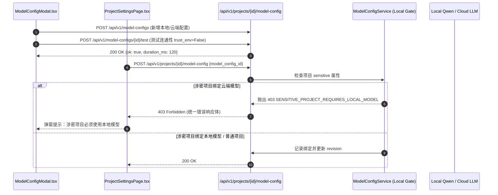

# 代码说明：模型配置弹窗前后端联调与涉密本地隔离守卫（INT-MODEL-CONFIG-MODAL）

## 1. 架构流转设计

`INT-MODEL-CONFIG-MODAL` 实现了前端模型配置交互与后端模型路由/守卫的完整胶水联调。



## 2. 关键代码说明

### 2.1 涉密项目本地模型强门禁
在 `backend/bid-core/icg/infra/model_config_storage.py` 及 `model_configs.py` 中：
```python
if project.sensitive and not (config.is_local or config.allow_sensitive):
    raise DomainError(403, "SENSITIVE_PROJECT_REQUIRES_LOCAL_MODEL", "敏感项目只能使用本地模型配置。")
```

### 2.2 内网请求防止透明代理劫持
在 `backend/bid-core/icg/api/ragflow.py` 中：
```python
client = httpx.Client(timeout=timeout, trust_env=False)
```
显式关闭 `trust_env`，确保即使开发者主机配置了系统代理或透明 VPN，发往内网 `192.168.x.x` 或本地大模型服务的 HTTP 请求也不会被意外劫持。

### 2.3 前端 ModelConfigModal.tsx 交互
- 采用 Layout First 布局，提供本地模型（Local Qwen / 私有化）与云端模型单选切换；
- API Key 输入框自动带掩码防护，更新时不强迫重新输入原密钥；
- 提供“连通性测试”按钮，即时反馈延迟并呈现测试结果状态提示。
