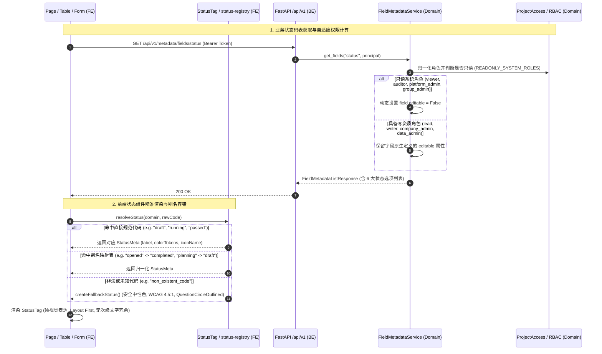

# 代码说明：状态注册表与元数据接口端到端契约联调（INT-STATUS-TAG-METADATA-GLUE）

## 1. 架构流转设计

`INT-STATUS-TAG-METADATA-GLUE` 打通前端状态标签注册表（`StatusTag` / `status-registry.ts`）与后端分类字段元数据字典服务（`FieldMetadataService`），确保 6 大核心业务状态码表单源对齐与角色自适应权限控制。



---

## 2. 关键代码说明

### 2.1 后端元数据服务分类扩充与全量聚合
在 `backend/bid-core/icg/domain/field_metadata.py` 中：
```python
class FieldMetadataService:
    def __init__(self, service: DemoService):
        self.service = service

    def resolve_category(self, category: str) -> str:
        cat_key = category.strip().lower()
        if cat_key == "all":
            return "all"
        if cat_key in METADATA_DEFINITIONS:
            return cat_key
        if cat_key in CATEGORY_ALIASES:
            return CATEGORY_ALIASES[cat_key]
        raise DomainError(404, "NOT_FOUND", f"未找到该分类的字段元数据：{category}。")

    def get_fields(self, category: str, principal: Principal) -> dict[str, Any]:
        from .project_access import ROLE_NORMALIZATION_MAP, READONLY_SYSTEM_ROLES

        canonical_category = self.resolve_category(category)
        user_role = getattr(principal.user, "role", "viewer") if principal and principal.user else "viewer"
        norm_role = ROLE_NORMALIZATION_MAP.get(user_role, user_role)
        is_readonly = norm_role in READONLY_SYSTEM_ROLES

        # 全量聚合查询
        if canonical_category == "all":
            all_fields: list[FieldMetadataItem] = []
            for cat_key, defn in METADATA_DEFINITIONS.items():
                if cat_key == "status":
                    continue  # 避免全量字段中混入重复的状态字段
                for item in defn["fields"]:
                    item_dict = dict(item)
                    if is_readonly:
                        item_dict["editable"] = False
                    all_fields.append(FieldMetadataItem(**item_dict))
            return {
                "category": "all",
                "category_name": "全部分类字段元数据",
                "total": len(all_fields),
                "fields": all_fields,
                "items": all_fields,
            }

        definition = METADATA_DEFINITIONS[canonical_category]
        fields_data: list[FieldMetadataItem] = []
        for item in definition["fields"]:
            item_dict = dict(item)
            if is_readonly:
                item_dict["editable"] = False
            fields_data.append(FieldMetadataItem(**item_dict))

        return {
            "category": canonical_category,
            "category_name": definition["category_name"],
            "total": len(fields_data),
            "fields": fields_data,
            "items": fields_data,
        }
```

### 2.2 前端状态别名容错扩展
在 `frontend/web/src/shared/status-registry.ts` 中扩展 `STATUS_ALIASES`：
```typescript
const STATUS_ALIASES: Record<StatusDomain, Record<string, string>> = {
  project: {
    drafting: 'in_progress',
    parsing: 'in_progress',
    checking: 'review',
    pending_confirm: 'review',
    exportable: 'completed',
    exported: 'completed',
    submitted: 'completed',
    opened: 'completed',
    closed: 'archived',
    cancelled: 'archived',
    planning: 'draft',
    done: 'completed',
  },
  chapter: {
    init: 'not_started',
    empty: 'not_started',
    pending: 'not_started',
    generating_ai: 'generating',
    in_review: 'reviewed',
    confirmed: 'reviewed',
    finalized: 'approved',
    locked: 'reviewed',
    stale: 'not_started',
    failed: 'not_started',
  },
  job: {
    pending: 'queued',
    succeeded: 'completed',
    canceled: 'cancelled',
    abort: 'cancelled',
    err: 'failed',
    processing: 'running',
    timeout: 'failed',
  },
  check: {
    hint: 'warning',
    caution: 'warning',
    disqualification: 'blocker',
    fail: 'blocker',
    failed: 'blocker',
    ok: 'passed',
    pass: 'passed',
    pending: 'warning',
    running: 'warning',
    incomplete: 'warning',
    has_blocker: 'blocker',
    warning_only: 'warning',
  },
  export: {
    waiting: 'idle',
    ready: 'idle',
    queued: 'idle',
    exporting: 'processing',
    generating: 'processing',
    building: 'processing',
    done: 'completed',
    success: 'completed',
    error: 'failed',
    expired: 'failed',
  },
  lock: {
    free: 'unlocked',
    idle: 'unlocked',
    self: 'locked_self',
    held: 'locked_self',
    locked: 'locked_other',
    other: 'locked_other',
    busy: 'locked_other',
    timeout: 'expired',
    taken_over: 'expired',
  },
};
```

---

## 3. 测试覆盖设计

在 `tests/backend/test_status_tag_metadata_glue.py` 中编写 4 个核心测试：
1. `test_get_field_metadata_all_category`：验证 `GET /api/v1/metadata/fields/all` 接口契约，校验字段总数（>=25）及标志性跨领域字段；
2. `test_six_status_domains_metadata_mapping_complete`：逐一校验 `project_status`, `chapter_status`, `job_status`, `check_status`, `export_status`, `lock_status` 代码表在 `/api/v1/metadata/fields/status` 与专用接口中的完整性；
3. `test_rbac_editable_permission_matrix_across_8_roles`：覆盖 8 大标准 RBAC 角色，断言只读角色（viewer, auditor, platform_admin, group_admin）所有字段均被自适应封退为 `editable=False`，写角色保留 `editable=True`；
4. `test_field_metadata_security_and_rfc7807_error_compliance`：验证未登录 401、非法 Token 401 与未知分类 404 错误响应及 RFC 7807 字段合规性。
