# 代码说明：异步任务中心与长任务流式通知前后端联调（INT-TASK-CENTER-GLUE）

## 1. 架构流转设计

`INT-TASK-CENTER-GLUE` 实现了非演示模式下长耗时后台任务从创建、持久化、实时事件推流到失败重试与取消的全生命周期前后端胶水链路。

```mermaid
sequenceDiagram
    autonumber
    participant UI as TaskCenter / JobProgress (FE)
    participant SSE as EventSource (/jobs/{id}/events)
    participant API as FastAPI /api/v1
    participant Domain as RecoverableJobs
    participant DB as demo_job (Repository)

    Note over UI,API: 1. 异步启动长任务
    UI->>API: POST /api/v1/projects/{pid}/generation/start (Idempotency-Key)
    API->>Domain: start() 启动章节生成/长任务
    Domain->>DB: save_job() 写入 demo_job (status=pending, progress=0)
    Domain-->>API: 202 Accepted {id: job_id, status: queued, allowed_actions: [cancel]}
    API-->>UI: 202 Accepted (Location: /api/v1/jobs/{job_id})

    Note over UI,API: 2. SSE 订阅与实时推流
    UI->>SSE: GET /api/v1/jobs/{id}/events (Last-Event-ID)
    SSE->>API: 建立 text/event-stream
    API->>Domain: events() 获取实时事件流
    Domain->>DB: update_job_progress(status=running, progress=40)
    Domain-->>SSE: id: job_id:1\nevent: job.progress\ndata: {progress: 40}
    Domain->>DB: update_job_progress(status=completed, progress=100)
    Domain-->>SSE: id: job_id:2\nevent: job.completed\ndata: {status: completed}
    SSE-->>UI: 解包 JobEvent 并触发 UI 响应式渲染，达到终态切断连接

    Note over UI,API: 3. 操作动作与权限控制 (allowedActions)
    alt 进行中任务取消
        UI->>API: POST /api/v1/jobs/{id}/cancel
        API->>Domain: cancel() 核验角色 (只读角色拦截 403)
        Domain->>DB: update_job_progress(status=cancelled)
        Domain-->>API: 200 OK {status: cancelled, allowed_actions: [retry]}
    else 失败/取消任务重试
        UI->>API: POST /api/v1/jobs/{id}/retry (仅项目负责人/管理员)
        API->>Domain: retry() 核验 lead/admin (只读或普通编写人拦截 403)
        Domain->>DB: update_job_progress(status=pending, progress=0)
        Domain-->>API: 200 OK {status: queued, allowed_actions: [cancel]}
    end
```



---

## 2. 关键代码说明

### 2.1 长任务重试端点与操作动作权限门禁
在 `backend/bid-core/icg/domain/recoverable_jobs.py` 中落地 `POST /api/v1/jobs/{job_id}/retry`：
```python
def retry(self, principal, job_id: str, key: str | None) -> dict:
    key = validate_key(key)
    request_fingerprint = fingerprint("job.retry:" + job_id, {}, None)

    def operation(state):
        job = self._visible(state, principal, job_id)
        norm = normalize_role(principal.user.role)
        is_lead = lead(state, job["project_id"], principal.user.id)
        is_admin = norm in (ROLE_COMPANY_ADMIN, ROLE_PLATFORM_ADMIN)
        if not (is_lead or is_admin) or norm in READONLY_SYSTEM_ROLES:
            raise DomainError(403, "PROJECT_LEAD_REQUIRED", "仅项目负责人或管理员可重试任务。")

        replay = lookup(state, job["project_id"], principal.user.id, key, request_fingerprint, self.demo._now())
        if replay is not None:
            return replay

        if job["status"] not in ("failed", "cancelled"):
            raise DomainError(409, "VERSION_CONFLICT", "只有失败或已取消的任务可以重试。")

        previous = job["status"]
        now = iso_time(self.demo._now())
        job["status"] = "queued"
        job["progress"] = 0
        job["message"] = "任务已重置排队，准备重新执行。"
        job["completed_at"] = None
        job["error"] = None
        self._append(job, "job.status_changed", payload={"from": previous, "to": "queued"})
        self._append(job, "job.progress", payload={"progress": 0, "message": "任务已重置排队，准备重新执行。"})

        self.repository.update_job_progress(
            job_id,
            progress=0,
            status="pending",
            step_name="任务已重新排队",
            error_json=None,
            result_json=None,
        )
        body = _public(job)
        remember(state, job["project_id"], principal.user.id, key, request_fingerprint, body, self.demo._now())
        return body
    return self.repository.transaction(operation)
```

### 2.2 多租户企业空间物理隔离
在 `_visible(state, principal, job_id)` 中核验租户与项目所属权：
```python
def _visible(self, state, principal, job_id: str) -> dict:
    job = state.recoverable_jobs.get(job_id)
    if job is None:
        persisted = self.repository.read_job(job_id) or state.jobs.get(job_id)
        if persisted:
            try:
                self.demo._project(state, principal, persisted["project_id"])
            except DomainError as error:
                if error.code == "NOT_FOUND":
                    raise DomainError(404, "NOT_FOUND", "未找到有权访问的任务。") from error
                raise
            ...
```
当跨公司用户访问其他企业租户的项目任务时，`_project` 抛出 404，统一转换为 404 `NOT_FOUND`，坚决杜绝因 403 泄露其他公司任务编号或项目存在性信息。

### 2.3 前端 SSE 事件载荷解包与流式驱动
在 `frontend/web/src/status/job-progress-sse.ts` 中增强 `handleMessageData`：
```typescript
const eventPayload = payload.payload;
const derivedStatus =
  payload.status ||
  eventPayload?.status ||
  (payload.type === 'job.completed'
    ? 'completed'
    : payload.type === 'job.failed'
    ? 'failed'
    : payload.type === 'job.cancelled'
    ? 'cancelled'
    : payload.type === 'job.status_changed'
    ? eventPayload?.to
    : undefined);

const derivedProgress =
  payload.percent ??
  payload.progress ??
  eventPayload?.progress ??
  (derivedStatus === 'completed' ? 100 : undefined);
```
兼容直接推送的 `JobProgressData` 对象与符合 OpenAPI 规范的 `JobEvent` 事件流，支持自动完成时切断连接并释放资源。
