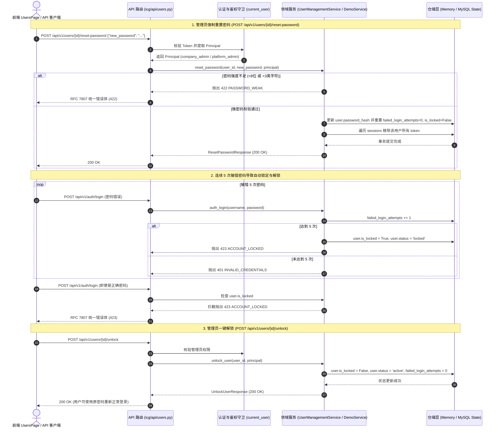

# INT-USER-SECURITY-OPS-GLUE 代码说明：用户角色分配、重置密码与账号解锁端到端契约联调

为什么有这个文件：记录前后端联调工单 INT-USER-SECURITY-OPS-GLUE（用户角色分配、重置密码与账号解锁端到端契约联调）的技术架构、核心领域模型、错误码冻结、前后端胶水层设计与自动化测试映射。

它解决什么问题：
1. 阐明用户安全运维领域服务（`POST /users/{id}/reset-password`、`POST /users/{id}/unlock`、`PATCH /users/{id}/role`）的端到端调用时序与事务控制；
2. 详解登录失败连续计数机制、自动置锁流转（`status="locked"`, `is_locked=True`）与 HTTP 423 `ACCOUNT_LOCKED` 拦截设计；
3. 详解强制密码重置事务中，Q28 强密码校验、凭据更新、失败计数清零及所有活跃会话（Token）即时作废算法；
4. 详解角色调配中的越权防护算法：超管保护（403 `SUPER_ADMIN_PROTECTED`）、管理员防自降权保护（403 `CANNOT_DEMOTE_SELF`）与跨租户防嗅探隔离（404 `NOT_FOUND`）；
5. 记录前后端类型契约对齐、OpenAPI 零漂移规范及专属集成测试映射。

---

## 1. 系统架构与交互时序



---

## 2. 核心领域逻辑与安全红线算法

### 2.1 登录连续失败与自动锁定机制
在 [backend/bid-core/icg/domain/domain.py](../../backend/bid-core/icg/domain/domain.py) 中：
```python
if user.is_locked:
    raise AppError(
        status_code=423,
        code="ACCOUNT_LOCKED",
        message="账号已被锁定，请联系管理员解锁",
        details={"username": username, "failed_login_attempts": user.failed_login_attempts, "max_attempts": 5},
    )

if not self.verify_password(password, user.password_hash):
    user.failed_login_attempts += 1
    if user.failed_login_attempts >= 5:
        user.is_locked = True
        user.status = "locked"
        self.save_state()
        raise AppError(
            status_code=423,
            code="ACCOUNT_LOCKED",
            message="账号已被锁定，请联系管理员解锁",
            details={"username": username, "failed_login_attempts": user.failed_login_attempts, "max_attempts": 5},
        )
    self.save_state()
    raise AppError(status_code=401, code="INVALID_CREDENTIALS", message="用户名或密码错误")
```

### 2.2 密码强制重置与活跃会话注销算法
在 [backend/bid-core/icg/domain/user_management.py](../../backend/bid-core/icg/domain/user_management.py) 中：
```python
def reset_password(self, user_id: str, new_password: str, principal: Principal) -> dict:
    # 1. 多租户与管理员权限鉴权
    user = self._get_user_or_raise(user_id, principal)
    self._check_admin_permission(principal, user.company_id)

    # 2. Q28 密码强度策略检查
    valid, msg = validate_password_strength(new_password)
    if not valid:
        raise AppError(status_code=422, code="PASSWORD_WEAK", message=msg)

    # 3. 凭据更新与锁定解除
    user.password_hash = hash_password(new_password)
    user.is_locked = False
    user.failed_login_attempts = 0
    if user.status == "locked":
        user.status = "active"

    # 4. 原子注销该用户全部活跃 Token
    state = self.repository.read()
    tokens_to_delete = [
        token for token, session in state.sessions.items()
        if session.user_id == user_id
    ]
    for token in tokens_to_delete:
        del state.sessions[token]

    self.repository.save(state)
    return {"user_id": user_id, "status": user.status, "message": "密码重置成功，该用户所有历史登录会话已即时失效"}
```

### 2.3 角色调配越权防御算法
在 `UserManagementService.update_role` 中：
```python
# 超管账号保护
if user.username == "admin" and new_role != "platform_admin":
    raise AppError(
        status_code=403,
        code="SUPER_ADMIN_PROTECTED",
        message="超级管理员账号角色不可修改",
        details={"user_id": user_id},
    )

# 企管自降权保护
if principal.user_id == user_id and principal.role == "company_admin" and new_role != "company_admin":
    raise AppError(
        status_code=403,
        code="CANNOT_DEMOTE_SELF",
        message="管理员不能将自己的角色降权",
        details={"user_id": user_id},
    )
```

---

## 3. 前端客户端胶水层封装（`user-management-api.ts`）

在 [frontend/web/src/admin/user-management-api.ts](../../frontend/web/src/admin/user-management-api.ts) 中输出强类型客户端函数：
```typescript
export interface ApiResetPasswordRequest {
  new_password: string;
}

export interface ApiResetPasswordResponse {
  user_id: string;
  status: string;
  message: string;
}

export interface ApiUnlockUserResponse {
  user_id: string;
  status: string;
  is_locked: boolean;
  message: string;
}

export interface ApiUpdateUserRoleRequest {
  role: string;
}

export async function resetUserPassword(
  userId: string,
  payload: ApiResetPasswordRequest,
  token?: string,
): Promise<ApiResetPasswordResponse> {
  return requestV1<ApiResetPasswordResponse>(`/users/${encodeURIComponent(userId)}/reset-password`, {
    method: 'POST',
    body: payload,
    token,
  });
}

export async function unlockUser(
  userId: string,
  token?: string,
): Promise<ApiUnlockUserResponse> {
  return requestV1<ApiUnlockUserResponse>(`/users/${encodeURIComponent(userId)}/unlock`, {
    method: 'POST',
    token,
  });
}

export async function updateUserRole(
  userId: string,
  payload: ApiUpdateUserRoleRequest,
  token?: string,
): Promise<ApiUserModel> {
  return requestV1<ApiUserModel>(`/users/${encodeURIComponent(userId)}/role`, {
    method: 'PATCH',
    body: payload,
    token,
  });
}
```

---

## 4. 自动化测试与验证映射

| 测试文件 | 测试用例 | 验证目标 | 状态 |
|---|---|---|---|
| `tests/backend/test_user_security_ops_glue.py` | `test_reset_password_full_flow` | 密码重置成功、历史 Token 401 作废、新凭据成功登录 | PASS (11.83s) |
| `tests/backend/test_user_security_ops_glue.py` | `test_reset_password_weak_rejected` | Q28 弱密码拦截 422 `PASSWORD_WEAK` | PASS |
| `tests/backend/test_user_security_ops_glue.py` | `test_login_failure_auto_lock_and_unlock_flow` | 连续 5 次输错置锁、正确密码仍 423 拦截、企管解锁恢复登录 | PASS |
| `tests/backend/test_user_security_ops_glue.py` | `test_role_switch_and_guards` | 8 大角色切换、超管降权 403 `SUPER_ADMIN_PROTECTED`、自降权 403 `CANNOT_DEMOTE_SELF` | PASS |
| `tests/backend/test_user_security_ops_glue.py` | `test_cross_company_isolation` | 跨租户修改拦截 404 `NOT_FOUND` 防嗅探 | PASS |
| `tests/backend/test_user_security_ops_glue.py` | `test_non_admin_forbidden` | 编写人等非管理员调用写端点拦截 403 `FORBIDDEN` | PASS |
| `frontend/web/tests/unit/user-security-ops-api.test.mjs` | 4 项 API 胶水单元测试 | 前端 API 方法请求路径、参数组装与响应解析准确性 | PASS |
| `frontend/web/tests/` (全量) | 455 项权威单元测试 | 整体前端无回归破坏 | PASS (10.23s) |
