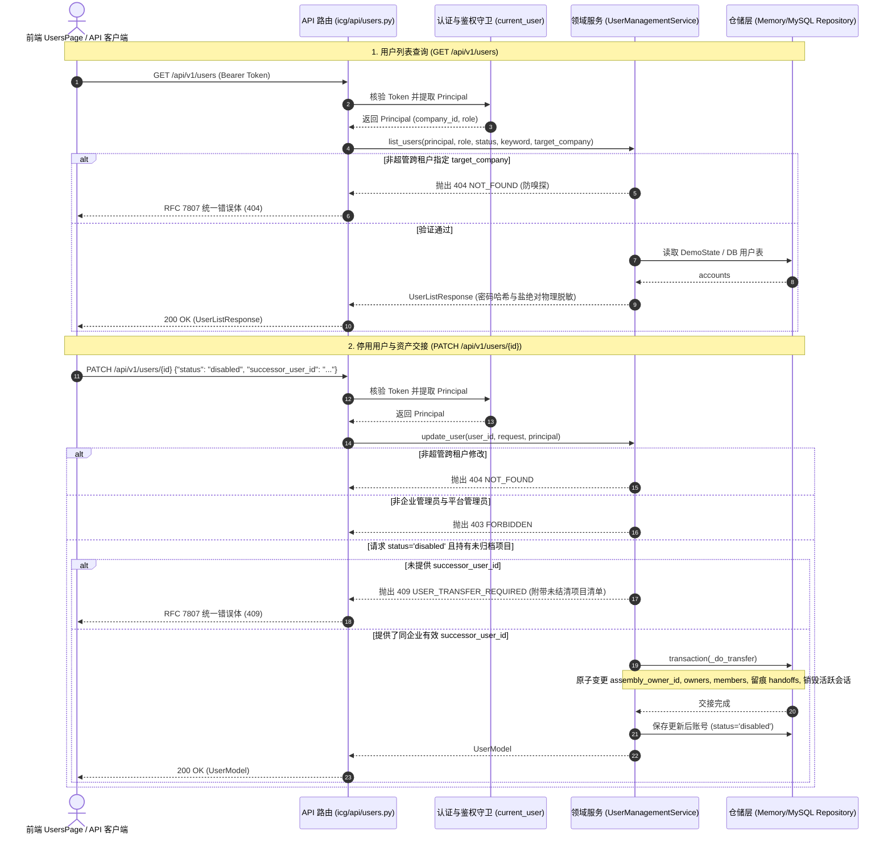

# INT-USER-TRANSFER-RBAC-GLUE 代码说明：用户管理与账号停用资产交接端到端契约联调

为什么有这个文件：记录前后端联调工单 INT-USER-TRANSFER-RBAC-GLUE（用户管理与账号停用资产交接端到端契约联调）的技术架构、核心领域模型、错误码冻结、资产转交算法实现与自动化测试映射。

它解决什么问题：
1. 阐明用户管理领域模型（`UserModel`、`CreateUserRequest`、`UpdateUserRequest`、`TransferUserAssetsRequest`）与路由契约设计；
2. 详解密码强度策略（Q28 定案：最少 8 位且至少满足大写、小写、数字、符号中的 3 类）与密码脱敏机制；
3. 详解核心业务红线：未结清在投项目停用阻断（409 `USER_TRANSFER_REQUIRED`）与平滑原子交接算法（`_execute_asset_transfer`）；
4. 阐明多租户强隔离（跨企业 404 `NOT_FOUND`）与 8 大标准 RBAC 角色的权限感知矩阵；
5. 记录前后端契约对齐、OpenAPI 零漂移规范及自动化测试验证映射。

---

## 1. 系统架构与交互时序



---

## 2. 核心领域逻辑与安全红线算法

### 2.1 密码强度动态校验算法（PRD §5.10.2 / Q28 定案）

在 `backend/bid-core/icg/domain/auth_service.py` 中落地 `validate_password_strength`：
```python
def validate_password_strength(password: str, min_length: int = 8, min_classes: int = 3) -> tuple[bool, str]:
    if not password or len(password) < min_length:
        return False, f"密码长度必须至少达到 {min_length} 位（当前长度 {len(password) if password else 0} 位）。"

    has_upper = bool(re.search(r"[A-Z]", password))
    has_lower = bool(re.search(r"[a-z]", password))
    has_digit = bool(re.search(r"[0-9]", password))
    has_symbol = bool(re.search(r"[~!@#$%^&*()_\-+=\[\]{}|;:,.<>?/]", password))

    classes_count = sum([has_upper, has_lower, has_digit, has_symbol])
    if classes_count < min_classes:
        return False, f"密码必须至少包含大写字母、小写字母、数字、特殊符号中的 {min_classes} 类字符（当前满足 {classes_count} 类）。"

    return True, ""
```

### 2.2 停用资产交接门禁算法（PRD §5.10.1 / M1-P10-F2）

在 `backend/bid-core/icg/domain/user_management.py` 中落地核心门禁检查与原子交接：

1. **扫描未转交在投项目与章节**（`_find_untransferred_assets`）：
   - 过滤条件：`project.company_id == user.company_id` 且 `not project.is_archived`；
   - 检查角色：标段总装负责人（`assembly_owner_id == user_id`）、分册负责人（`owners.values() == user_id`）、团队成员（`members[user_id]` 的项目角色为 `lead` 或 `writer`）以及创建人；
   - 检查章节：`chapter.assignee_id == user_id` 或章节正处于该用户编辑锁（`chapter.lock.user_id == user_id`）。
2. **阻断判定**：
   - 若存在在投资产且未提供 `successor_user_id`，立即抛出 409 `USER_TRANSFER_REQUIRED`，并在 `details` 中输出结构化清单。
3. **原子平滑交接执行**（`_execute_asset_transfer`）：
   - 校验接收人合法性：必须存在、不能为被停用者本人、必须同属当前企业、自身状态不能为 `disabled`；
   - 在单一数据库事务（`self.repository.transaction`）中完成：
     - 将 `assembly_owner_id` 替换为新接收人；
     - 将各分册负责人 `owners[vol]` 替换为新接收人；
     - 将 `members` 中旧用户移除并加入新用户，保留历史权限；
     - 项目团队记录交接历史日志 `handoffs.append({"from_user_id", "to_user_id", "transferred_at", "reason"})`；
     - 将未完结章节的编写人 `assignee_id` 迁移至新接收人并安全释放旧用户的编辑锁；
     - 记录安全审计事件 `audit.append({"action": "user.deactivate_and_transfer", ...})`；
     - 销毁被停用用户的所有活跃会话（`sessions`）。

---

## 3. RFC 7807 错误体与错误码冻结

在 `backend/bid-core/icg/domain/frozen_error_codes.py` 与 `backend/bid-core/icg/domain/errors.py` 中严格按字母序登记冻结错误码：

| 错误码 | HTTP 状态码 | 业务场景 | 统一错误体 details 结构 |
|---|---|---|---|
| `PASSWORD_WEAK` | 422 Unprocessable Entity | 新增用户时密码强度不足（<8位或<3类字符） | `{"field": "password"}` |
| `USER_TRANSFER_REQUIRED` | 409 Conflict | 停用持有在投未归档项目的用户但未指定接收人 | `{"user_id": str, "untransferred_projects": list, "untransferred_chapters": list, "required_action": str}` |
| `VALIDATION_ERROR` | 422 Unprocessable Entity | 交接人不存在、为本人、跨企业或已停用 | `{"field": "successor_user_id"}` |
| `NOT_FOUND` | 404 Not Found | 目标用户不存在或跨租户访问（防嗅探） | 无 |
| `FORBIDDEN` | 403 Forbidden | 非管理员角色尝试写操作或尝试停用超管 admin | 无 |

---

## 4. 前端类型化客户端契约胶水

在 `frontend/web/src/admin/user-management-api.ts` 中封装对齐 `/api/v1/users` 的纯类型化客户端：

```typescript
export async function fetchUsers(params?: {
  role?: string;
  status?: string;
  keyword?: string;
  company_id?: string;
}): Promise<UserListResponse>;

export async function fetchUser(userId: string): Promise<UserModel>;

export async function createUser(data: CreateUserRequest): Promise<UserModel>;

export async function updateUser(userId: string, data: UpdateUserRequest): Promise<UserModel>;

export async function transferUserAssets(
  userId: string,
  data: TransferUserAssetsRequest,
): Promise<TransferUserAssetsResponse>;
```

---

## 5. 自动化测试验证映射

| 测试文件 | 测试用例 | 验证目标与红线断言 |
|---|---|---|
| `tests/backend/test_user_transfer_rbac_glue.py` | `test_unauthenticated_user_api_blocked_401` | 未提供 Bearer Token 访问用户管理接口统一拦截 401 `UNAUTHENTICATED` |
| `tests/backend/test_user_transfer_rbac_glue.py` | `test_user_list_retrieval_and_sanitization` | 超管跨企业与企管本企业调阅，密码哈希与盐绝对物理脱敏 |
| `tests/backend/test_user_transfer_rbac_glue.py` | `test_password_strength_validation_422` | Q28 密码强度策略核验，弱密码严格拦截 422 `PASSWORD_WEAK` |
| `tests/backend/test_user_transfer_rbac_glue.py` | `test_deactivation_without_transfer_blocked_409` | 核心红线：未结清在投项目直接停用拦截 409 `USER_TRANSFER_REQUIRED` |
| `tests/backend/test_user_transfer_rbac_glue.py` | `test_deactivation_with_successor_transfer_success` | 传入有效接收人平滑交接项目负责人与编写人、留痕并成功停用 |
| `tests/backend/test_user_transfer_rbac_glue.py` | `test_tenant_and_rbac_isolation` | 跨企业访问 404 `NOT_FOUND` 防嗅探，非管理员修改 403 `FORBIDDEN` |
| `frontend/web/tests/unit/user-management-api.test.mjs` | `用户管理 API 函数导出与静态 AST 契约断言` | 前端客户端胶水函数导出完整且与 `/api/v1/users` 契约端点 100% 对齐 |
