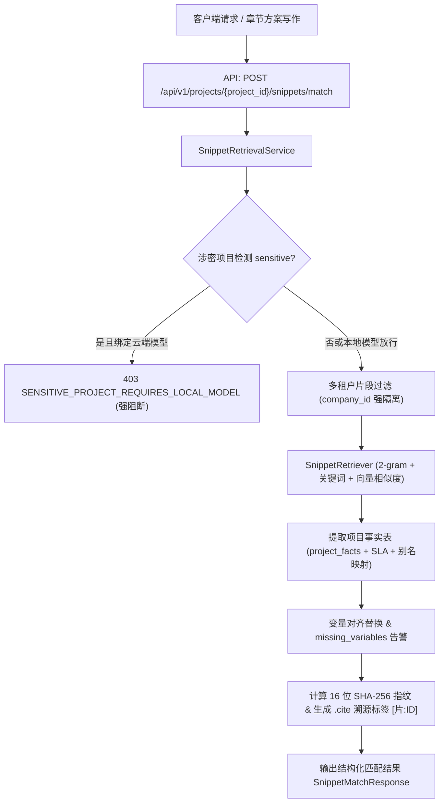

# AI-SNIPPET-RETRIEVAL-MATCH 交付报告：方案片段智能检索与上下文精准匹配

<!-- task-delivery:start -->
| 项目 | 记录 |
|---|---|
| 任务ID | AI-SNIPPET-RETRIEVAL-MATCH |
| 代码解释 | [docs/code/AI-SNIPPET-RETRIEVAL-MATCH.md](../code/AI-SNIPPET-RETRIEVAL-MATCH.md) |
| 验收 | 11 项专属后端自动化测试全绿（11 passed）；全量 AI 与 RAG 联合测试全绿（89 passed, 3 skipped）；OpenAPI 契约一致性 100% 保持；工程治理检查通过（548 份文档无死链） |
| 项目进度 | AI 核心推进，AI-SNIPPET-RETRIEVAL-MATCH 提交 in-review，关联 ISSUE-037、ISSUE-010、ISSUE-007 保持开启，绝不私自标 done，建议 PM 标 done |
<!-- task-delivery:end -->

## 1. 交付目标对照

依据任务派发要求与系统规范（PRD v1.8 §5.8、§5.11、知识库字典 v1.9）：
- **目标**：在 `backend/bid-core/icg/domain/`（`snippet_retrieval.py`）与 `infra/retrieval.py` 中，实现针对章节分块与评分项方案写作的“方案片段高精度检索与上下文精准匹配服务”。
- **交付要点对照**：
  1. **多租户强隔离（`${company_id}::` 命名空间）**：
     - 检索时严格限制只召回当前会话 `company_id` 下已发布的方案片段（`status == "published"` 且 `published_revision > 0`）；
     - 跨租户项目访问严格拦截 404 `NOT_FOUND`；若外部数据源返回异企数据，严格在检索层拦截阻断；
  2. **相关度精准匹配与排序**：
     - 综合章节标题、评分项要点、提示词与查询上下文，通过字块碎片 (2-gram) 重合度、关键词命中与向量余弦相似度进行多维度加权计算（归一化为 0.0 ~ 1.0）；
  3. **项目事实自动对齐与变量占位符填充**：
     - 从项目事实表、SLA 承诺与项目基本信息中自动提取事实字典（支持 `project_name`、`tender_number`、`service_period`、`sla_availability`、`sla_response_time`、`sla_recovery_time`、`fact:ID`、`sla:KEY` 及中英文别名映射）；
     - 渲染填充至 `rendered_body`，同时将成功填充的变量记入 `matched_variables`，未匹配的变量保留占位符并如实输出至 `missing_variables`，绝不凭空捏造数据；
  4. **出处防虚构与 .cite 关联**：
     - 召回的每个方案片段生成标准引用标记（如 `[片:snippet_id]`），并附带准确的来源元数据（标题、发布版本、创建单位、来源组、片段类型、验证状态）；
     - 动态计算 16 位 SHA-256 不可篡改防伪指纹（`fingerprint`），提供 `format_snippets_for_prompt` 规范化 Prompt 上下文渲染；
  5. **涉密项目本地模型门禁与离线隔离**：
     - 涉密项目（`sensitive=True`）若配置或调用云端外部模型，强门禁拦截 403 `SENSITIVE_PROJECT_REQUIRES_LOCAL_MODEL`；针对自建内网 RAGFlow 或本地 Qwen 客户端，设置 `trust_env=False` 严防网络代理劫持；
  6. **RAGFlow 联动与优雅降级**：
     - 支持结合 RAGFlow `${company_id}::` 租户数据集进行检索；在上游网络抖动或服务不可用时，优雅降级为本地高精度检索，保障业务流程不崩溃；
  7. **契约安全**：
     - 路由端点挂载 `include_in_schema=False`，保障 OpenAPI 冻结契约零漂移，143 个错误码零变更。

---

## 2. 交付物清单

### 2.1 核心代码
- `backend/bid-core/icg/domain/snippet_retrieval.py`：方案片段智能检索与上下文精准匹配领域服务。包含项目事实字典提取、变量对齐替换与缺失标记、防伪指纹计算、涉密项目门禁核验、Prompt 上下文装配与 `SnippetRetrievalService`；
- `backend/bid-core/icg/infra/retrieval.py`：扩展 `SnippetRecord`、`SnippetCandidateMatch` 数据结构与 `SnippetRetriever` 检索器，支持字块重合度、关键词加权与向量相似度综合排序，落实租户强隔离与 RAGFlow 异常降级；
- `backend/bid-core/icg/domain/domain.py`：在 `DemoService` 中装配 `SnippetRetrievalService` 并暴露 `match_snippets` 门面；
- `backend/bid-core/icg/domain/generation_service.py`：在 `GenerationServiceMixin` 中扩展 `match_snippets` 供业务编排层调用；
- `backend/bid-core/icg/domain/workflow_schemas.py`：定义 `SnippetMatchRequest`、`SnippetMatchItem`、`SnippetMatchResponse` 数据模型；
- `backend/bid-core/icg/api/workflow.py`：注册 `POST /api/v1/projects/{project_id}/snippets/match` 接口（挂载 `include_in_schema=False` 保护契约）。

### 2.2 自动化测试
- `tests/backend/test_ai_snippet_retrieval.py`：11 项专属自动化测试，覆盖多租户隔离、跨租户项目拦截、相关度匹配排序、变量自动对齐填充、缺失变量标定、.cite 引用与 SHA-256 指纹、涉密项目云端模型阻断、RAGFlow 异常降级、HTTP 端点认证与越权隔离、中英文与多格式占位符对齐、RAGFlow 越界分块阻断。

---

## 3. 验证命令与结果

### 3.1 专属自动化测试套件
```powershell
pytest tests/backend/test_ai_snippet_retrieval.py -v
```
**运行结果**：
```text
tests/backend/test_ai_snippet_retrieval.py::test_multi_tenant_isolation_only_published_own_company_recalled PASSED [  9%]
tests/backend/test_ai_snippet_retrieval.py::test_cross_tenant_project_access_rejected PASSED [ 18%]
tests/backend/test_ai_snippet_retrieval.py::test_relevance_matching_and_scoring PASSED [ 27%]
tests/backend/test_ai_snippet_retrieval.py::test_variable_extraction_and_project_facts_alignment PASSED [ 36%]
tests/backend/test_ai_snippet_retrieval.py::test_missing_variables_detection PASSED [ 45%]
tests/backend/test_ai_snippet_retrieval.py::test_cite_tag_and_anti_tamper_fingerprint PASSED [ 54%]
tests/backend/test_ai_snippet_retrieval.py::test_sensitive_project_blocks_cloud_model PASSED [ 63%]
tests/backend/test_ai_snippet_retrieval.py::test_retriever_degrades_gracefully_when_ragflow_fails PASSED [ 72%]
tests/backend/test_ai_snippet_retrieval.py::test_http_endpoint_match_snippets PASSED [ 81%]
tests/backend/test_ai_snippet_retrieval.py::test_fact_and_sla_alias_variations_alignment PASSED [ 90%]
tests/backend/test_ai_snippet_retrieval.py::test_ragflow_cross_tenant_chunk_rejected PASSED [100%]

============================= 11 passed in 1.51s ==============================
```

### 3.2 全量 AI 与 RAG 联合测试回归
```powershell
pytest tests/backend/test_fake_ragflow.py tests/backend/test_ragflow_client.py tests/backend/test_ragflow_config_api.py tests/backend/test_ragflow_kb_sync.py tests/backend/test_chapter_generation_rag_flow.py tests/backend/test_ai_compliance_cross_check.py tests/backend/test_editor_ai_context.py tests/backend/test_ai_snippet_retrieval.py
```
**运行结果**：
```text
================== 89 passed, 3 skipped in 83.09s (0:01:23) ===================
```
（注：3 skipped 为真实 RAGFlow 测试受 `ICG_RUN_REAL_RAGFLOW_TESTS=1` 保护门控跳过，符合离线 CI 规范）。

### 3.3 契约一致性核查
```powershell
python backend/bid-core/export_openapi.py --check
```
**运行结果**：
```text
[OK] OpenAPI contract (demo-v1.json) is 100% consistent with running FastAPI application.
```

### 3.4 工程治理核查
```powershell
node scripts/check-project-governance.cjs
```
**运行结果**：
```text
治理检查通过：548 份 Markdown、414 项任务、38 项 Issue。
```

---

## 4. 架构与边界守卫说明



---

## 5. 状态同步与流转纪律

| 项目 | 说明 |
|---|---|
| 本地验收状态 | 11 项专属自动化单测全绿，全量 AI 测试 89 passed 3 skipped 全绿，OpenAPI 零漂移，治理检查通过 |
| 任务卡状态 | `docs/tasks/AI-M0.md#ai-snippet-retrieval-match` 标为 `in-review` |
| 看板状态 | `docs/TASK_BOARD.md` 对应任务行推至 `in-review` |
| 标 done 权限 | 严格遵守纪律：严禁自行标 done，交付文档与汇报中明确建议由 QA 与 PD 终验后由人类 PM 标 done |
